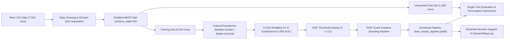
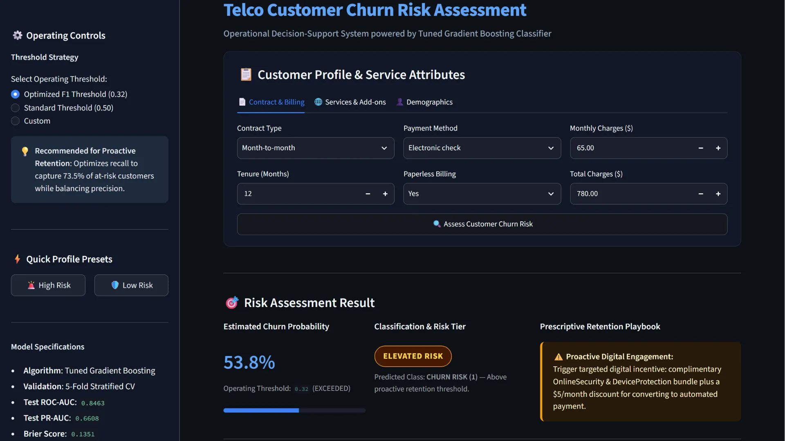
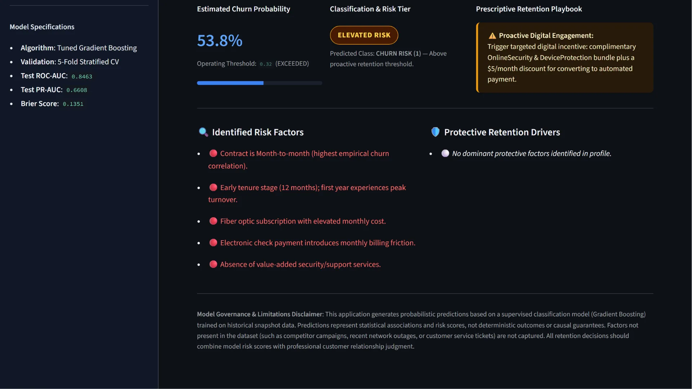
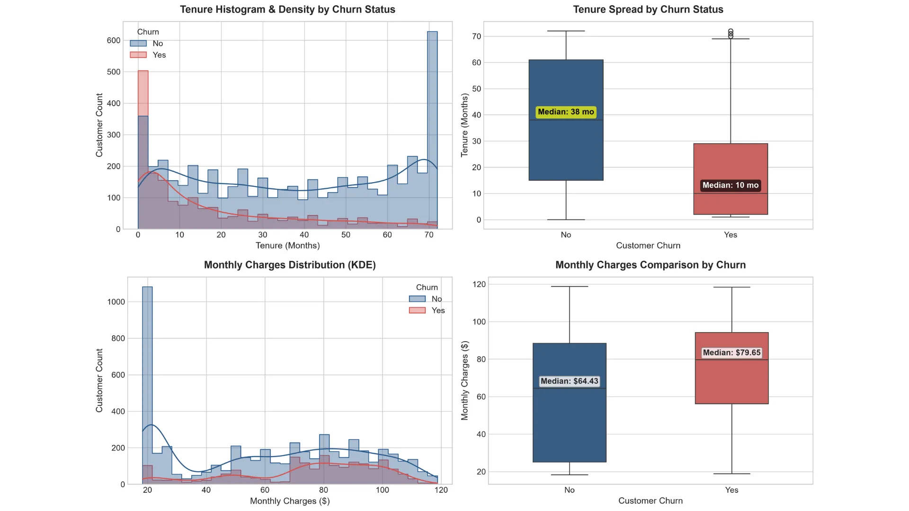
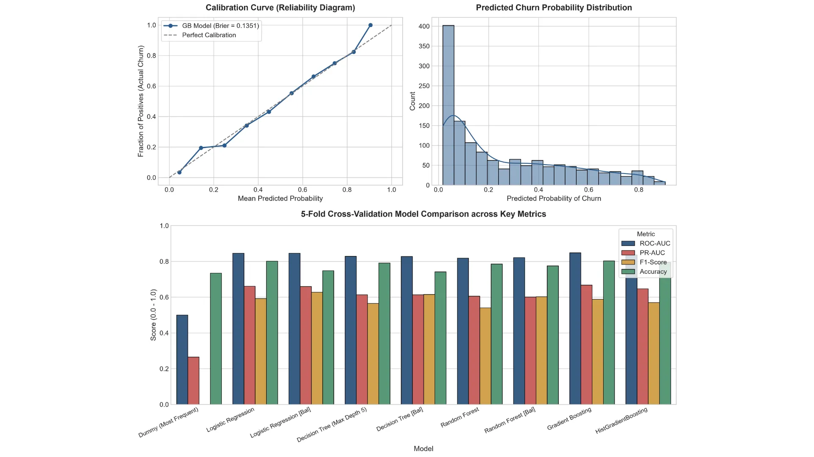
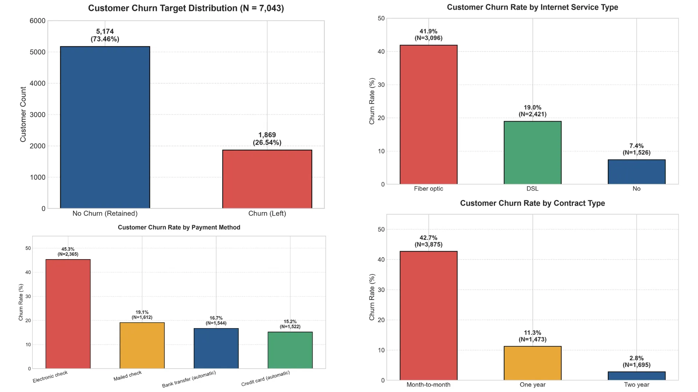
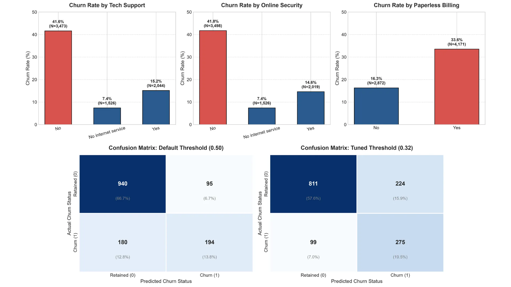
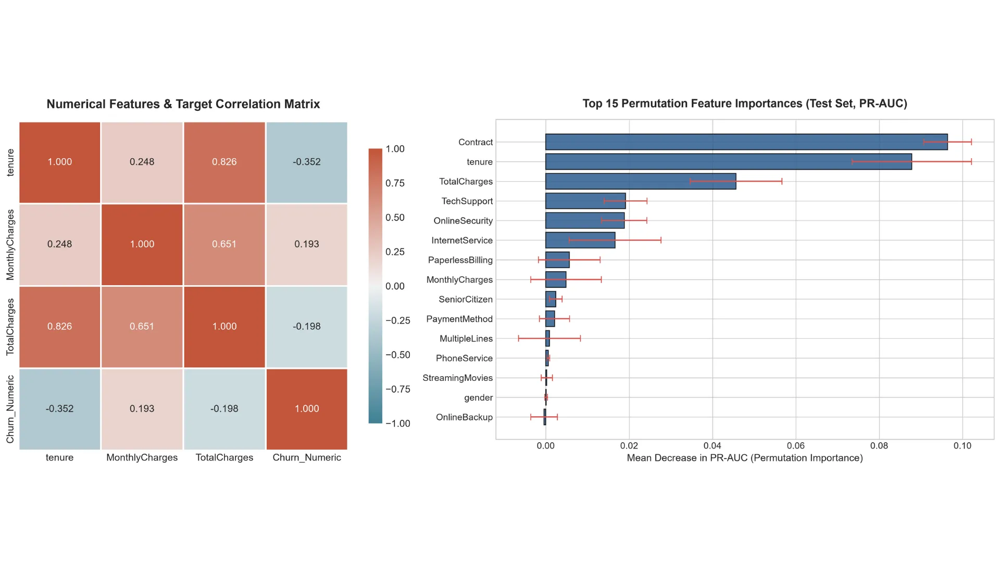

# Customer Churn Prediction with Supervised Classifiers


## Project Overview

Customer Churn Prediction with Supervised Classifiers is an end-to-end supervised machine learning pipeline and decision-support system built to identify telecommunications customers at risk of cancelling their subscriptions. Using structured customer account, demographic, contract, service, and billing records, the project benchmarks multiple supervised classification algorithms under strict data-leakage controls, tunes hyperparameters for imbalanced churn detection, calibrates the operating decision threshold on out-of-fold validation predictions, and exposes the serialized production pipeline through an interactive dark-mode Streamlit application.

## Problem Statement & Objectives

In subscription telecommunications services, customer attrition directly erodes recurring revenue, while untargeted retention campaigns waste outreach incentives on loyal subscribers. Because historical churn accounts represent a minority class (26.54%), naive accuracy is misleading and proactive retention requires calibrated risk ranking alongside recall-oriented decision thresholds.

- Build a leakage-free preprocessing and modeling pipeline using `scikit-learn` `ColumnTransformer` and `Pipeline` abstractions.
- Audit data quality anomalies—specifically blank `TotalCharges` entries for zero-tenure accounts—and validate imputation stability via cross-validated sensitivity analysis.
- Quantify empirical churn drivers across contract terms, tenure cohorts, internet infrastructure, support add-ons, and payment methods through exploratory data analysis.
- Benchmark candidate supervised classifiers via 5-fold Stratified Cross-Validation and tune top contenders using Precision-Recall AUC (`average_precision`).
- Optimize the classification probability threshold strictly on out-of-fold training predictions to balance churn capture (recall) against outreach precision before a single untouched test evaluation.
- Interpret predictive drivers using test-set Permutation Feature Importance and deliver an interactive Streamlit interface for operational risk stratification.

## Data & Input Sources

The project uses the tabular Telco Customer Churn dataset located at [`dataset/original/Telco-Customer-Churn.csv`](dataset/original/Telco-Customer-Churn.csv), containing 7,043 customer snapshot records across 21 columns. After removing the unique `customerID` identifier and encoding `Churn` (`Yes` = 1, `No` = 0), 19 candidate predictors (3 continuous numerical features and 16 categorical attributes) are passed into the modeling pipeline.

| Attribute | Description |
|---|---|
| **Dataset / Input Source** | Telco Customer Churn (`Telco-Customer-Churn.csv`) |
| **Source** | [`dataset/original/Telco-Customer-Churn.csv`](dataset/original/Telco-Customer-Churn.csv) |
| **Format** | CSV (Tabular) |
| **Samples / Records** | 7,043 customer records (5,634 train / 1,409 test) |
| **Features / Input Shape** | 19 predictors (3 continuous: `tenure`, `MonthlyCharges`, `TotalCharges`; 16 categorical including `SeniorCitizen`, `Contract`, `InternetService`, `PaymentMethod`, and add-ons) |
| **Target / Label** | `Churn` binary indicator: `Yes` = 1 (1,869 samples / 26.54%), `No` = 0 (5,174 samples / 73.46%) |

## Data Preprocessing & Feature Engineering

All data cleaning, stratified partitioning, and feature encoding steps are implemented in [`src/data_preprocessing.py`](src/data_preprocessing.py) to guarantee strict isolation between training and test partitions. Programmatic inspection confirmed zero duplicate rows and identified 11 blank `TotalCharges` strings (`tenure = 0`, `Churn = No`), which were assigned `0.0` via domain-consistent zero imputation and verified against median imputation via 5-fold Logistic Regression sensitivity testing in [`metrics/sensitivity_analysis.json`](metrics/sensitivity_analysis.json) (`0.8461` vs `0.8461` CV ROC-AUC; `0.6615` vs `0.6614` CV PR-AUC).

| Transformation | Input Features | Output / Configuration |
|---|---|---|
| **Whitespace Trimming & Numeric Coercion** | All string columns & `TotalCharges` | Stripped strings; coerced `TotalCharges` to float with `0.0` domain fill for `tenure == 0` |
| **Identifier & Target Isolation** | `customerID`, `Churn`, `Churn_Numeric` | Dropped from `X`; `Churn_Numeric` extracted as binary `y` |
| **Categorical Type Casting** | 16 categorical features (including `SeniorCitizen`) | Cast to `str` for consistent `OneHotEncoder` handling |
| **Numerical Transformer** | `tenure`, `MonthlyCharges`, `TotalCharges` | `SimpleImputer(strategy="median")` followed by `StandardScaler()` |
| **Categorical Transformer** | 16 categorical predictors | `SimpleImputer(strategy="most_frequent")` followed by `OneHotEncoder(handle_unknown="ignore", sparse_output=False)` |

1. Load raw CSV data, strip leading/trailing whitespace across string columns, and coerce `TotalCharges` to numeric.
2. Apply domain zero imputation (`0.0`) to the 11 blank `TotalCharges` records belonging to newly onboarded `tenure = 0` accounts and encode `Churn` (`Yes` -> `1`, `No` -> `0`).
3. Drop `customerID` and target columns, separate the 3 continuous numerical predictors from the 16 categorical predictors, and perform an 80/20 stratified train/test split (`test_size=0.2`, `random_state=42`, `stratify=y`).
4. Encapsulate `num` and `cat` pipelines inside a `ColumnTransformer` fitted exclusively inside training folds during cross-validation and once on the full training partition before final test scoring.

## Tech Stack

| Category | Technology | Purpose |
|---|---|---|
| **Programming Language** | Python | Core scripting, modeling, evaluation, and application runtime |
| **ML & Preprocessing** | Scikit-Learn | `Pipeline`, `ColumnTransformer`, classifiers, `GridSearchCV`, metrics, calibration, permutation importance |
| **Data Manipulation** | Pandas, NumPy | CSV ingestion, cleaning, feature splitting, and numerical aggregations |
| **Statistical Computation** | SciPy | Underlying scientific/statistical array support |
| **Visualization** | Matplotlib, Seaborn | 300 DPI EDA charts, ROC/PR curves, confusion matrices, calibration plots, and feature importance plots |
| **Model Serialization** | Joblib | Persistence and loading of the fitted `best_model_pipeline.joblib` |
| **Web Decision Support** | Streamlit | Interactive dark-mode churn risk assessment web application |
| **Interactive Notebook** | Jupyter Notebook | Reproducible exploratory and evaluation walkthrough in [`notebooks/churn_project.ipynb`](notebooks/churn_project.ipynb) |

## Machine Learning Approach

This project formulates customer churn prediction as a supervised binary classification problem under moderate class imbalance (2.77:1 negative-to-positive ratio). Rather than optimizing naive accuracy, model selection and hyperparameter tuning target Precision-Recall AUC (`average_precision`) and ROC-AUC, paired with out-of-fold probability threshold tuning to maximize F1-score and churn recall for proactive retention workflows.

| Dimension | Specification |
|---|---|
| **Learning Paradigm** | Supervised Learning |
| **Problem Domain** | Telecommunications Customer Retention & Attrition Risk |
| **ML Task** | Binary Classification (`Churn`: 0 vs 1) |
| **Input Representation** | 19 tabular customer demographic, contract, service, and billing predictors |
| **Target / Output** | Calibrated churn probability $P(\text{Churn} = 1 \mid X)$ and thresholded binary class |
| **Optimization Objective** | Precision-Recall AUC (`average_precision`) during `GridSearchCV`; F1-maximization on OOF probabilities for decision cutoff selection |

## Model Overview

Nine supervised baseline and ensemble variants were benchmarked via 5-fold Stratified Cross-Validation in [`src/train.py`](src/train.py), with the tuned `GradientBoostingClassifier` selected as the primary production model inside [`models/best_model_pipeline.joblib`](models/best_model_pipeline.joblib).

| Attribute | Details |
|---|---|
| **Primary Model** | `GradientBoostingClassifier` (Tuned) |
| **Model Family** | Sequential Tree-Based Gradient Boosting Ensemble |
| **Framework** | Scikit-Learn (`Pipeline` with `ColumnTransformer` + `GradientBoostingClassifier`) |
| **Candidate Models Benchmarked** | `DummyClassifier`, `LogisticRegression` (Default & Balanced), `DecisionTreeClassifier` (Max Depth 5, Default & Balanced), `RandomForestClassifier` (Default & Balanced), `GradientBoostingClassifier`, `HistGradientBoostingClassifier` |
| **Input / Output** | Raw 19-feature customer DataFrame -> continuous churn probability `[0, 1]` and binary classification |
| **Training Status** | Trained from scratch on the 80% stratified training partition (`N = 5,634`); no external pretrained weights used |

## ML Workflow

1. **Exploratory Data Analysis ([`src/eda.py`](src/eda.py))**: Inspect target class balance, tenure and charge distributions, numerical correlations, and churn rates across contract, internet, support, and payment categories, saving 9 figures to [`figures/`](figures/).
2. **Data Cleaning & Stratified Splitting ([`src/data_preprocessing.py`](src/data_preprocessing.py))**: Coerce `TotalCharges`, apply domain zero fill, isolate `customerID`, partition 80/20 stratified train/test sets (`random_state=42`), and construct the leakage-free `ColumnTransformer`.
3. **Imputation Sensitivity & Model Benchmarking ([`src/train.py`](src/train.py))**: Compare `domain_zero` vs `median` imputation via 5-fold CV and evaluate all 9 candidate classifiers across ROC-AUC, PR-AUC, F1, Recall, Precision, Accuracy, and Specificity, persisting outputs to [`metrics/sensitivity_analysis.json`](metrics/sensitivity_analysis.json) and [`metrics/cv_comparison_results.json`](metrics/cv_comparison_results.json).
4. **Hyperparameter Tuning ([`src/train.py`](src/train.py))**: Execute 5-fold `GridSearchCV` optimizing `average_precision` (PR-AUC) for Gradient Boosting, Logistic Regression, and Random Forest, writing results to [`metrics/tuning_results.json`](metrics/tuning_results.json).
5. **Out-of-Fold Threshold Optimization & Test Evaluation ([`src/evaluate.py`](src/evaluate.py))**: Sweep decision thresholds (`0.10`–`0.90`) on 5-fold OOF training predictions to select $t^* = 0.32$, fit the final tuned Gradient Boosting pipeline on all 5,634 training rows, save [`models/best_model_pipeline.joblib`](models/best_model_pipeline.joblib), and evaluate once on the untouched test partition (`N = 1,409`), recording [`metrics/test_metrics.json`](metrics/test_metrics.json).
6. **Explainability & Interactive Serving ([`src/evaluate.py`](src/evaluate.py), [`streamlit/app.py`](streamlit/app.py))**: Compute test-set Permutation Feature Importance (`n_repeats=10`, [`metrics/permutation_importance.json`](metrics/permutation_importance.json)), render evaluation plots, and serve real-time predictions and retention playbooks via Streamlit. Detailed findings are also documented in [`final_report.md`](final_report.md) and [`notebooks/churn_project.ipynb`](notebooks/churn_project.ipynb).

## ML Pipeline Architecture

The architecture enforces strict train/test separation from raw CSV ingestion through `ColumnTransformer` preprocessing, cross-validated hyperparameter search, out-of-fold threshold calibration, final test evaluation, and serialized pipeline serving in Streamlit.



## Model Training & Configuration

Training and hyperparameter search were executed exclusively on the 5,634-sample training partition in [`src/train.py`](src/train.py) using `StratifiedKFold(n_splits=5, shuffle=True, random_state=42)`. The winning tuned `GradientBoostingClassifier` configuration was refitted on the full training partition inside [`src/evaluate.py`](src/evaluate.py) before serialization.

| Configuration Parameter | Value |
|---|---|
| **Final Estimator** | `GradientBoostingClassifier` |
| **Random Seed (`RANDOM_STATE`)** | `42` |
| **Train / Test Split** | 80% Train (`5,634`) / 20% Test (`1,409`), stratified on `Churn_Numeric` |
| **Cross-Validation Strategy** | 5-Fold `StratifiedKFold` (`shuffle=True`, `random_state=42`) |
| **Tuning Metric** | `average_precision` (PR-AUC) |
| **Selected `n_estimators`** | `200` |
| **Selected `learning_rate`** | `0.03` |
| **Selected `max_depth`** | `3` |
| **Selected `subsample`** | `0.8` |
| **OOF Decision Threshold ($t^*$)** | `0.32` (swept `0.10` to `0.90` in 81 steps maximizing OOF F1-score) |

```python
best_pipe = Pipeline([
    ("preprocessor", build_preprocessor(num_features, cat_features)),
    ("classifier", GradientBoostingClassifier(
        learning_rate=0.03,
        max_depth=3,
        n_estimators=200,
        subsample=0.8,
        random_state=42,
    )),
])
```

### Hyperparameter Tuning & Experiment Tracking

Hyperparameter search was conducted using `GridSearchCV` with 5-fold Stratified Cross-Validation on the training set (`metrics/tuning_results.json`), optimizing `average_precision` (PR-AUC) across three model families.

| Model | Search Space | Best Parameters | Best CV PR-AUC |
|---|---|---|---|
| **Gradient Boosting** | `n_estimators`: [100, 150, 200], `learning_rate`: [0.03, 0.05, 0.1], `max_depth`: [3, 4], `subsample`: [0.8, 1.0] | `learning_rate=0.03`, `max_depth=3`, `n_estimators=200`, `subsample=0.8` | **0.6719** |
| **Random Forest** | `n_estimators`: [100, 200], `max_depth`: [8, 12, 16], `min_samples_split`: [5, 10], `class_weight`: [None, balanced, balanced_subsample] | `class_weight=None`, `max_depth=8`, `min_samples_split=10`, `n_estimators=200` | 0.6644 |
| **Logistic Regression** | `C`: [0.01, 0.05, 0.1, 0.5, 1.0, 5.0], `class_weight`: [None, balanced], `solver`: [lbfgs, liblinear] | `C=1.0`, `class_weight=None`, `solver='lbfgs'` | 0.6615 |

### Model Comparison & Selection

Nine candidate classifier configurations were compared on the 5,634 training samples using 5-fold Stratified Cross-Validation (`metrics/cv_comparison_results.json`). `Gradient Boosting` achieved the highest validation ROC-AUC (`0.8482`) and validation PR-AUC (`0.6676` untuned, improving to `0.6719` after tuning) while maintaining a controlled train-to-validation ROC-AUC gap (`0.8882` vs `0.8482`), whereas default `Random Forest` memorized training folds (`0.9999` train ROC-AUC vs `0.8180` validation ROC-AUC).

| Classifier Variant | CV ROC-AUC | CV PR-AUC | CV F1-Score | CV Recall | CV Precision | CV Accuracy | Train ROC-AUC |
|---|---|---|---|---|---|---|---|
| **Dummy (Most Frequent)** | 0.5000 | 0.2654 | 0.0000 | 0.0000 | 0.0000 | 0.7346 | 0.5000 |
| **Logistic Regression (Default)** | 0.8461 | 0.6615 | 0.5924 | 0.5438 | 0.6521 | 0.8019 | 0.8496 |
| **Logistic Regression (Balanced)** | 0.8460 | 0.6601 | **0.6282** | **0.8013** | 0.5169 | 0.7485 | 0.8495 |
| **Decision Tree (Max Depth 5)** | 0.8288 | 0.6139 | 0.5649 | 0.5130 | 0.6345 | 0.7914 | 0.8544 |
| **Decision Tree (Balanced)** | 0.8275 | 0.6139 | 0.6152 | 0.7773 | 0.5097 | 0.7421 | 0.8548 |
| **Random Forest (Default)** | 0.8180 | 0.6062 | 0.5403 | 0.4756 | 0.6271 | 0.7854 | 0.9999 |
| **Random Forest (Balanced)** | 0.8216 | 0.6007 | 0.6025 | 0.6421 | 0.5676 | 0.7753 | 1.0000 |
| **Gradient Boosting** | **0.8482** | **0.6676** | 0.5880 | 0.5291 | **0.6622** | **0.8033** | 0.8882 |
| **HistGradientBoosting** | 0.8364 | 0.6471 | 0.5703 | 0.5124 | 0.6439 | 0.7954 | 0.9619 |

### Model Artifacts & Checkpoints

All serialized model weights, preprocessing transformers, evaluation metrics, and visualization figures generated by the training and evaluation modules are stored directly in the repository.

| Artifact | Format | Purpose | Location |
|---|---|---|---|
| **Fitted Production Pipeline** | Joblib (`.joblib`) | Complete `ColumnTransformer` + tuned `GradientBoostingClassifier` pipeline | [`models/best_model_pipeline.joblib`](models/best_model_pipeline.joblib) |
| **CV Comparison Metrics** | JSON | 5-fold Stratified CV train & validation metrics for 9 classifiers | [`metrics/cv_comparison_results.json`](metrics/cv_comparison_results.json) |
| **Hyperparameter Tuning Results** | JSON | Best parameters & CV PR-AUC for GB, RF, and LR | [`metrics/tuning_results.json`](metrics/tuning_results.json) |
| **Final Test Metrics** | JSON | Untouched test-set evaluation at thresholds `0.50` and `0.32` | [`metrics/test_metrics.json`](metrics/test_metrics.json) |
| **Sensitivity Analysis** | JSON | `domain_zero` vs `median` imputation CV benchmark | [`metrics/sensitivity_analysis.json`](metrics/sensitivity_analysis.json) |
| **Permutation Importance** | JSON | Top 15 test-set permutation importance scores (`average_precision`) | [`metrics/permutation_importance.json`](metrics/permutation_importance.json) |

## Model Evaluation & Results

Final evaluation was executed once on the untouched 20% test partition (`N = 1,409`: 1,035 retained, 374 churned) as recorded in [`metrics/test_metrics.json`](metrics/test_metrics.json). Threshold-independent metrics confirm strong probability ranking and calibration (**Test ROC-AUC = `0.8463`**, **Test PR-AUC = `0.6608`**, **Brier Score = `0.1351`**), while shifting the operating cutoff from `0.50` to the OOF-selected `0.32` substantially improves churn recall and F1-score.

| Metric | Default Threshold (`0.50`) | Tuned Threshold (`0.32`) |
|---|---|---|
| **Test ROC-AUC** | 0.8463 | 0.8463 |
| **Test PR-AUC (Average Precision)** | 0.6608 | 0.6608 |
| **Brier Score** | 0.1351 | 0.1351 |
| **Accuracy** | 80.48% | 77.08% |
| **Precision** | 67.13% | 55.11% |
| **Recall (Churn Capture)** | 51.87% | **73.53%** |
| **F1-Score** | 0.5852 | **0.6300** |
| **Specificity** | 90.82% | 78.36% |
| **Confusion Matrix (`TP / FP / FN / TN`)** | 194 / 95 / 180 / 940 | **275** / 224 / **99** / 811 |

- Shifting from `0.50` to `0.32` increases true-positive churn detection from 194 to 275 customers (+81 churners captured) and cuts missed churners nearly in half (180 down to 99 false negatives).
- Operating at `0.32` raises retention outreach volume from 289 customers (20.5% of the test cohort) to 499 customers (35.4%), trading 12.02 percentage points of precision for +21.66 percentage points of recall.
- Limitations remain: the dataset is a single cross-sectional snapshot lacking longitudinal usage telemetry, billing dispute logs, or local competitor pricing signals, and associations cannot be interpreted as causal effects.

### Model Explainability & Interpretability

Model interpretability was evaluated on the untouched test partition using `sklearn.inspection.permutation_importance` across 10 random repeats (`random_state=42`) measuring mean decrease in `average_precision` (PR-AUC), with results stored in [`metrics/permutation_importance.json`](metrics/permutation_importance.json) and visualized in item #9 of the Results Visualization & Preview section below.

| Rank | Feature | Mean PR-AUC Decrease | Std Dev | Observed Domain Pattern |
|---|---|---|---|---|
| **1** | `Contract` | 0.0964 | 0.0057 | Month-to-month contracts exhibit 42.7% churn vs 11.3% (1-year) and 2.8% (2-year) |
| **2** | `tenure` | 0.0878 | 0.0143 | Churned customers show median tenure of 10 months vs 38 months for retained |
| **3** | `TotalCharges` | 0.0456 | 0.0110 | Cumulative billing reflects account longevity and tenure interaction (`r = 0.826`) |
| **4** | `TechSupport` | 0.0191 | 0.0051 | Accounts without tech support churn at 41.6% vs 15.2% with active support |
| **5** | `OnlineSecurity` | 0.0188 | 0.0054 | Accounts without online security churn at 41.8% vs 14.6% with active security |
| **6** | `InternetService` | 0.0166 | 0.0110 | Fiber optic subscribers churn at 41.9% vs 19.0% (DSL) and 7.4% (no internet) |

## Results Visualization & Preview

### 1. Streamlit Risk Assessment Console & Operating Controls

The primary Streamlit decision-support interface configured in cohesive dark mode (`#0e1117`), displaying sidebar threshold strategy controls (Optimized F1 Threshold `0.32`, Standard `0.50`, Custom), quick High/Low Risk presets, verified test performance specifications, and tabbed customer attribute inputs producing an interactive 53.8% Elevated Risk assessment.

### 2. Risk Stratification, Retention Playbook & Driver Breakdown

The lower assessment panel translating the predicted 53.8% churn probability into an `ELEVATED RISK` tier, prescriptive digital engagement actions, itemized risk indicators (month-to-month contract, 12-month tenure, fiber optic, electronic check, missing add-ons), protective factors, and a statistical governance disclaimer.

### 3. Tenure & Monthly Charges Distributions by Churn Status

Four-panel exploratory comparison demonstrating that churned accounts cluster sharply in early tenure (median 10 months vs 38 months for retained accounts) and pay higher monthly charges (median \$79.65 vs \$64.43 for retained subscribers).

### 4. Total Charges Distribution & Churn Comparison

Histogram/KDE and boxplot comparison of cumulative `TotalCharges`, showing a right-skewed distribution where retained customers accumulate substantially higher lifetime spend (median \$1,679.5 vs \$703.5 for churners) due to longer tenure.

### 5. Probability Calibration, Score Distribution & 5-Fold CV Model Comparison

Three-panel diagnostic view showing the Gradient Boosting reliability diagram (Brier Score `0.1351`) closely tracking perfect calibration, the right-skewed test-set predicted probability distribution, and the 5-fold Stratified CV comparison across all nine classifier variants.

### 6. Test-Set ROC & Precision-Recall Curves

Discrimination curves for the final tuned Gradient Boosting pipeline on the untouched test partition (`N = 1,409`), achieving a Test ROC-AUC of `0.8463` and a Test PR-AUC of `0.6608` (more than 2.49× above the 26.5% no-skill churn baseline).

### 7. Churn Target Balance & Categorical Risk Segments

Four-panel exploratory breakdown detailing the 73.46% / 26.54% class distribution across 7,043 records alongside elevated churn rates among Month-to-month contracts (42.7%), Fiber optic subscribers (41.9%), and Electronic check payers (45.3%).

### 8. Support Add-On Churn Rates & Threshold Confusion Matrices

Top row contrasts churn rates across `TechSupport` (41.6% without vs 15.2% with), `OnlineSecurity` (41.8% without vs 14.6% with), and `PaperlessBilling` (33.6% vs 16.3%), while the bottom row compares test-set confusion matrices at default threshold `0.50` (194 TP / 180 FN) versus tuned threshold `0.32` (275 TP / 99 FN).

### 9. Numerical Correlation Matrix & Permutation Feature Importance

Side-by-side interpretability analysis pairing the numerical Pearson correlation matrix (`tenure` vs `TotalCharges` `r = 0.826`, `tenure` vs `Churn_Numeric` `r = -0.352`) with the top 15 test-set Permutation Feature Importances ranked by mean PR-AUC decrease (`Contract`, `tenure`, and `TotalCharges` leading).

## Prerequisites

- **Operating System:** Windows, macOS, or Linux (CPU execution supported; no GPU required)
- **Python Runtime:** Python 3.10+ (the repository notebook metadata records Python 3.15.1)
- **Package Manager:** `pip`
- **Python Dependencies (from [`requirements.txt`](requirements.txt)):** `numpy>=2.0.0`, `pandas>=2.0.0`, `scikit-learn>=1.4.0`, `matplotlib>=3.8.0`, `seaborn>=0.13.0`, `joblib>=1.3.0`, `scipy>=1.12.0`, `streamlit>=1.30.0`

## Installation & Setup

1. Clone the repository and navigate to the project root directory:
   ```bash
   git clone https://github.com/weztcy/Customer-Churn-Prediction-with-Supervised-Classifiers.git
   cd "Customer Churn Prediction with Supervised Classifiers"
   ```
2. Create and activate an isolated Python virtual environment:
   ```bash
   python -m venv .venv
   # Windows PowerShell:
   .venv\Scripts\Activate.ps1
   # macOS / Linux:
   source .venv/bin/activate
   ```
3. Install the project dependencies:
   ```bash
   pip install -r requirements.txt
   ```

## Usage & Execution

The repository includes modular scripts for EDA, preprocessing verification, cross-validated training/tuning, test-set evaluation, and an interactive Streamlit web application. Note that [`src/data_preprocessing.py`](src/data_preprocessing.py), [`src/eda.py`](src/eda.py), [`src/train.py`](src/train.py), [`src/evaluate.py`](src/evaluate.py), and [`streamlit/app.py`](streamlit/app.py) default to `dataset/Telco-Customer-Churn.csv` and `outputs/` relative paths, whereas the committed repository organizes those assets under [`dataset/original/Telco-Customer-Churn.csv`](dataset/original/Telco-Customer-Churn.csv), [`figures/`](figures/), [`metrics/`](metrics/), and [`models/`](models/).

1. **Generate Exploratory Data Analysis Figures** (pass the dataset path if running against `dataset/original/`):
   ```bash
   python -c "from src.eda import run_eda; run_eda('dataset/original/Telco-Customer-Churn.csv')"
   ```
2. **Run Sensitivity Analysis, Model Benchmarking & GridSearchCV Tuning** (ensure `dataset/Telco-Customer-Churn.csv` is accessible or point `load_and_clean_data` to `dataset/original/Telco-Customer-Churn.csv`):
   ```bash
   python src/train.py
   ```
3. **Run Final Test Evaluation, Threshold Tuning & Pipeline Export**:
   ```bash
   python src/evaluate.py
   ```
4. **Launch the Streamlit Decision-Support Application** (expects the serialized model at `outputs/models/best_model_pipeline.joblib` relative to the working directory):
   ```bash
   python -m streamlit run streamlit/app.py
   ```

### Model Deployment & Serving

Real-time single-customer inference is served locally via the Streamlit application in [`streamlit/app.py`](streamlit/app.py) using the dark-mode theme configured in [`.streamlit/config.toml`](.streamlit/config.toml).

1. Ensure the trained pipeline [`models/best_model_pipeline.joblib`](models/best_model_pipeline.joblib) is available at `outputs/models/best_model_pipeline.joblib` (or update `MODEL_PATH` in [`streamlit/app.py`](streamlit/app.py)).
2. Start the local Streamlit server with headless configuration enabled in [`.streamlit/config.toml`](.streamlit/config.toml):
   ```bash
   python -m streamlit run streamlit/app.py
   ```
3. Use the sidebar controls to switch between the `0.32` F1-optimized threshold, `0.50` default threshold, or custom cutoffs, load `High Risk` / `Low Risk` presets, and inspect stratified risk tiers (`CRITICAL`, `ELEVATED`, `LOW`) with prescriptive retention playbooks.

## Reproducibility & Execution

All stochastic operations—including the stratified 80/20 train/test split, 5-fold `StratifiedKFold` shuffling, classifier initialization (`LogisticRegression`, `DecisionTreeClassifier`, `RandomForestClassifier`, `GradientBoostingClassifier`, `HistGradientBoostingClassifier`), and test-set `permutation_importance`—are pinned to `RANDOM_STATE = 42` in [`src/data_preprocessing.py`](src/data_preprocessing.py), [`src/train.py`](src/train.py), and [`src/evaluate.py`](src/evaluate.py).

1. Use the minimum dependency versions declared in [`requirements.txt`](requirements.txt) and the immutable source dataset at [`dataset/original/Telco-Customer-Churn.csv`](dataset/original/Telco-Customer-Churn.csv).
2. Re-run `src/train.py` followed by `src/evaluate.py` to regenerate [`metrics/sensitivity_analysis.json`](metrics/sensitivity_analysis.json), [`metrics/cv_comparison_results.json`](metrics/cv_comparison_results.json), [`metrics/tuning_results.json`](metrics/tuning_results.json), [`metrics/test_metrics.json`](metrics/test_metrics.json), [`metrics/permutation_importance.json`](metrics/permutation_importance.json), and [`models/best_model_pipeline.joblib`](models/best_model_pipeline.joblib).
3. Inspect [`notebooks/churn_project.ipynb`](notebooks/churn_project.ipynb) (generated via [`scripts/create_notebook.py`](scripts/create_notebook.py)) for a consolidated cell-by-cell walkthrough of the preprocessing, cross-validation, tuning, and test evaluation results; minor floating-point variations may still occur across different `scikit-learn` or `numpy` patch releases.

## Contributing

Contributions to improve feature engineering, calibration diagnostics, or operational tooling are welcome following a standard pull-request workflow:

1. Fork the repository.
2. Create a branch for the change.
3. Make the changes.
4. Run relevant checks or tests when available.
5. Commit and push the branch.
6. Open a pull request with a clear explanation.

## License

This project is licensed under the MIT License.
See the [LICENSE](LICENSE) file for details.

## Author & Contact

**Yohanes Dimas Pratama**

- GitHub: [github.com/weztcy](https://github.com/weztcy)
- Portfolio: [yohanesdimas.com](https://yohanesdimas.com)
- LinkedIn: [linkedin.com/in/yohanes-dimas](https://www.linkedin.com/in/yohanes-dimas)
