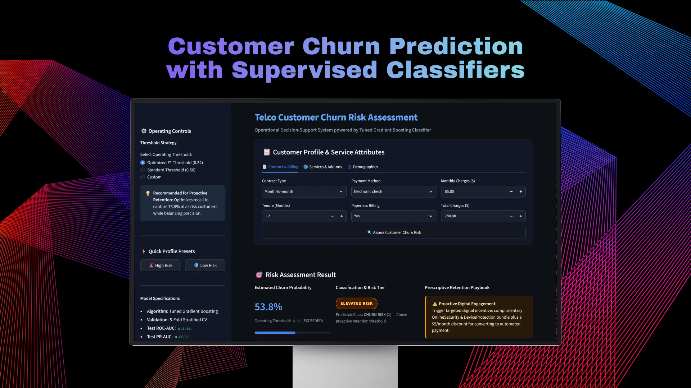
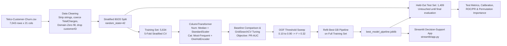
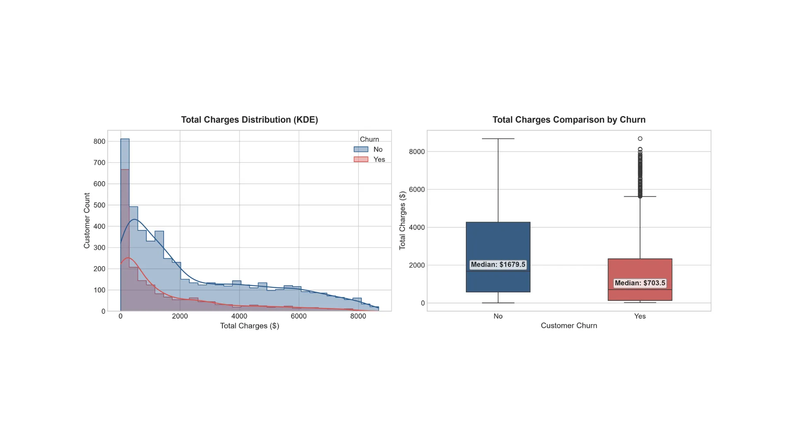
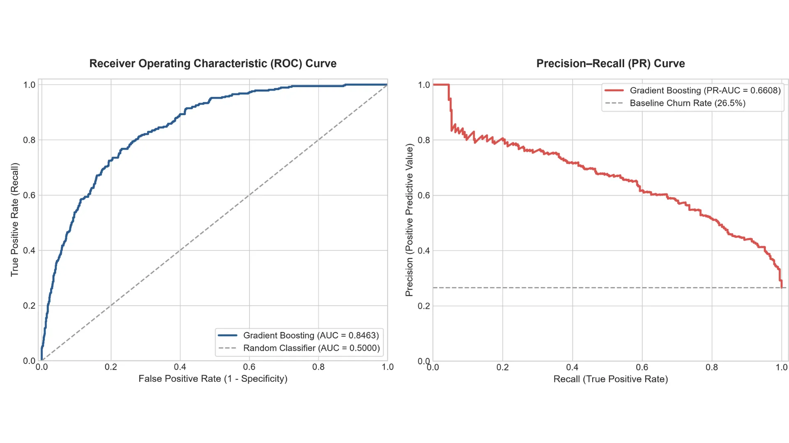

# Customer Churn Prediction with Supervised Classifiers




## Project Overview

Customer Churn Prediction with Supervised Classifiers is an end-to-end supervised machine learning project designed to predict telecommunications customer attrition and support proactive retention operations. Built on the Telco Customer Churn dataset (`N = 7,043`), the repository integrates exploratory data analysis, leakage-free preprocessing via `scikit-learn` `ColumnTransformer` pipelines, 5-fold stratified cross-validation across nine classifier variants, PR-AUC-driven `GridSearchCV` hyperparameter tuning, out-of-fold decision threshold optimization (`0.32`), permutation feature importance analysis, and an interactive dark-mode Streamlit decision-support application.

## Problem Statement & Objectives

In subscription telecommunications, customer attrition directly erodes recurring revenue, while untargeted retention campaigns waste outreach capacity and incentives on stable accounts. Because only 26.54% of customers in the dataset churned, naive accuracy is misleading and proactive retention requires calibrated risk probabilities paired with a recall-oriented operating threshold.

- Construct a reproducible, data-leakage-free preprocessing and modeling pipeline using `scikit-learn` `ColumnTransformer` and `Pipeline`.
- Audit and resolve data-quality anomalies, specifically validating `TotalCharges` coercion and domain-consistent zero imputation versus median imputation via cross-validation sensitivity analysis.
- Quantify empirical churn drivers across contract types, tenure cohorts, internet services, add-on bundles, and payment methods through exploratory analysis.
- Benchmark baseline and ensemble classifiers using 5-fold Stratified Cross-Validation and tune top candidates with `GridSearchCV` optimizing Precision-Recall AUC (`average_precision`).
- Optimize the binary classification threshold strictly on out-of-fold training predictions to balance churn recall against retention outreach precision.
- Interpret model predictions via test-set permutation feature importance and expose the serialized pipeline through an operational Streamlit risk assessment interface.

## Data & Input Sources

The project uses a single tabular cross-sectional customer snapshot dataset located at [`dataset/original/Telco-Customer-Churn.csv`](dataset/original/Telco-Customer-Churn.csv), containing demographic attributes, account tenure, service subscriptions, contract terms, billing metrics, and binary churn outcomes.

| Attribute | Description |
| :--- | :--- |
| **Dataset / Input Source** | Telco Customer Churn |
| **Source** | [`dataset/original/Telco-Customer-Churn.csv`](dataset/original/Telco-Customer-Churn.csv) |
| **Format** | CSV (tabular) |
| **Samples / Records** | 7,043 customer records (5,634 train / 1,409 test after stratified 80/20 split; 0 duplicate rows) |
| **Features / Input Shape** | 19 candidate predictors (3 continuous numerical: `tenure`, `MonthlyCharges`, `TotalCharges`; 16 categorical including `SeniorCitizen`, `Contract`, `InternetService`, `PaymentMethod`, and service add-ons); `customerID` dropped |
| **Target / Label** | `Churn` (`Yes` = 1: 1,869 records [26.54%]; `No` = 0: 5,174 records [73.46%]) |

## Data Preprocessing & Feature Engineering

All cleaning, feature typing, and transformations are implemented in [`src/data_preprocessing.py`](src/data_preprocessing.py) so that every transformer fits exclusively on training folds without test-set leakage. Structural service categories such as `No internet service` and `No phone service` are preserved explicitly rather than collapsed into generic `No` labels.

| Transformation | Input Features | Output / Behavior |
| :--- | :--- | :--- |
| **Whitespace Trimming & Numeric Coercion** | All string columns and `TotalCharges` | Strips leading/trailing whitespace and coerces 11 blank `TotalCharges` strings (`tenure = 0`, `Churn = No`) to `NaN` |
| **Domain-Zero Imputation** | `TotalCharges` (11 missing rows) | Fills missing `TotalCharges` with `0.0` for zero-tenure accounts (verified against median imputation in [`metrics/sensitivity_analysis.json`](metrics/sensitivity_analysis.json)) |
| **Target & Identifier Isolation** | `customerID`, `Churn` | Encodes `Churn_Numeric` (`Yes` -> `1`, `No` -> `0`) and drops `customerID` from predictors |
| **Numerical Pipeline** | `tenure`, `MonthlyCharges`, `TotalCharges` | Applies `SimpleImputer(strategy="median")` followed by `StandardScaler()` |
| **Categorical Pipeline** | 16 categorical columns (`SeniorCitizen` cast to `str`) | Applies `SimpleImputer(strategy="most_frequent")` followed by `OneHotEncoder(handle_unknown="ignore", sparse_output=False)` |

1. Load CSV records, strip whitespace across string/object columns, and coerce `TotalCharges` to floating-point values.
2. Impute the 11 zero-tenure blank `TotalCharges` entries with `0.0` (domain-zero rule) and encode binary `Churn_Numeric`.
3. Drop `customerID`, cast categorical predictors (including `SeniorCitizen`) to strings, and perform an 80/20 stratified train/test split (`random_state=42`).
4. Encapsulate numerical scaling and categorical one-hot encoding inside a `ColumnTransformer` (`remainder="drop"`) fitted inside each cross-validation fold and once on the full training set.

## Tech Stack

| Category | Technology | Purpose |
| :--- | :--- | :--- |
| **Language** | Python | Core scripting, modeling, evaluation, and web application runtime |
| **Data Manipulation** | pandas, NumPy | CSV ingestion, string cleaning, numeric coercion, array math, and threshold sweeps |
| **Machine Learning** | scikit-learn | `ColumnTransformer`, `Pipeline`, classifiers, `StratifiedKFold`, `GridSearchCV`, calibration, and permutation importance |
| **Statistical Computation** | SciPy | Scientific numerical backend supporting statistical and ML routines |
| **Visualization** | Matplotlib, Seaborn | 300-DPI exploratory charts, ROC/PR curves, calibration plots, confusion matrices, and feature importance bars |
| **Model Serialization** | joblib | Persisting and loading the fitted preprocessing + classifier pipeline |
| **Web Interface** | Streamlit | Dark-mode interactive churn risk assessment and retention playbook dashboard |
| **Interactive Notebook** | Jupyter Notebook | End-to-end documented experimental walkthrough in [`notebooks/churn_project.ipynb`](notebooks/churn_project.ipynb) |

## Machine Learning Approach

The problem is formulated as supervised binary classification under moderate class imbalance (2.77:1 ratio of non-churners to churners). Candidate linear, tree-based, bagging, and gradient-boosted classifiers are wrapped in a unified preprocessing pipeline and evaluated primarily by rank-ordering and precision-recall discrimination rather than raw accuracy alone.

| Aspect | Implementation |
| :--- | :--- |
| **Learning Paradigm** | Supervised Learning |
| **Problem Domain** | Telecommunications Customer Retention |
| **ML Task** | Binary Classification (`Churn` probability estimation and risk tiering) |
| **Input** | 19 tabular customer account, billing, demographic, and service features |
| **Target / Output** | Binary churn label (`0` = Retained, `1` = Churn) and calibrated probability score |
| **Evaluation Priority** | PR-AUC (`average_precision`) and ROC-AUC for ranking; F1-score and Recall at tuned threshold (`0.32`) for outreach decisions |

## Model Overview

Nine classifier configurations were benchmarked in cross-validation, with a tuned `GradientBoostingClassifier` selected as the primary production model inside a combined `scikit-learn` `Pipeline`.

| Attribute | Details |
| :--- | :--- |
| **Primary Model** | Tuned `GradientBoostingClassifier` (`scikit-learn`) |
| **Model Family** | Sequential Gradient Boosted Decision Trees (Ensemble) |
| **Pipeline Structure** | `ColumnTransformer` (`num` + `cat` encoders) -> `GradientBoostingClassifier` |
| **Pretrained Status** | Trained from scratch on the 80% Telco training partition (`N = 5,634`) |
| **Comparison Baselines** | Dummy (`most_frequent`), Logistic Regression (Default & Balanced), Decision Tree (Max Depth 5, Default & Balanced), Random Forest (Default & Balanced), HistGradientBoosting |
| **Operating Threshold** | `0.32` (optimized via out-of-fold training F1-score) alongside `0.50` default reference |

## ML Workflow

The end-to-end modeling workflow is documented in [`final_report.md`](final_report.md) and implemented across modular scripts and [`notebooks/churn_project.ipynb`](notebooks/churn_project.ipynb):

1. **Exploratory Data Analysis** ([`src/eda.py`](src/eda.py)): Inspect class balance, tenure bimodality, contract churn rates, internet/support add-on effects, payment channels, billing distributions, and numerical correlations across 9 EDA figures.
2. **Data Cleaning & Stratified Splitting** ([`src/data_preprocessing.py`](src/data_preprocessing.py)): Trim whitespace, coerce `TotalCharges`, apply domain-zero imputation, drop `customerID`, and create a stratified 80/20 split (`5,634` train / `1,409` test, `random_state=42`).
3. **Imputation Sensitivity & Baseline Benchmarking** ([`src/train.py`](src/train.py)): Compare domain-zero vs. median imputation via 5-fold Logistic Regression CV, then benchmark 9 classifier variants across 5-fold Stratified CV on the training set.
4. **Hyperparameter Optimization** ([`src/train.py`](src/train.py)): Run 5-fold `GridSearchCV` optimizing `average_precision` (PR-AUC) for Gradient Boosting, Logistic Regression, and Random Forest.
5. **Out-of-Fold Threshold Tuning & Test Evaluation** ([`src/evaluate.py`](src/evaluate.py)): Sweep thresholds `0.10–0.90` on 5-fold out-of-fold training probabilities (`t* = 0.32`), refit the tuned Gradient Boosting pipeline on the full training set, export [`models/best_model_pipeline.joblib`](models/best_model_pipeline.joblib), and evaluate once on the held-out test set.
6. **Model Interpretation & Decision Support** ([`src/evaluate.py`](src/evaluate.py), [`streamlit/app.py`](streamlit/app.py)): Compute 10-repeat test-set permutation feature importance (`PR-AUC` drop) and serve real-time risk scoring and tiered retention playbooks in Streamlit.

## ML Pipeline Architecture

The architecture enforces strict separation between training-fold transformations and test-set evaluation by packaging imputation, scaling, one-hot encoding, and gradient boosting inside a single serialized `Pipeline`.



## Model Training & Configuration

Training and hyperparameter search were executed exclusively on the 5,634-sample training partition using 5-fold `StratifiedKFold(n_splits=5, shuffle=True, random_state=42)`. The winning Gradient Boosting configuration was refitted once on the full training set before test evaluation.

| Configuration Parameter | Value | Notes |
| :--- | :--- | :--- |
| **Algorithm** | `GradientBoostingClassifier` | Sequential tree boosting with deviance loss |
| **`n_estimators`** | `200` | Tuned via `GridSearchCV` from `[100, 150, 200]` |
| **`learning_rate`** | `0.03` | Tuned via `GridSearchCV` from `[0.03, 0.05, 0.1]` |
| **`max_depth`** | `3` | Tuned via `GridSearchCV` from `[3, 4]` |
| **`subsample`** | `0.8` | Tuned via `GridSearchCV` from `[0.8, 1.0]` |
| **Cross-Validation Strategy** | 5-Fold Stratified K-Fold | `shuffle=True`, `random_state=42` |
| **Optimization Metric** | `average_precision` (PR-AUC) | Selected for class-imbalanced churn ranking |
| **Decision Threshold** | `0.32` | Maximizes out-of-fold training F1 (`0.6436`) |

```python
best_pipe = Pipeline([
    ("preprocessor", preprocessor),
    ("classifier", GradientBoostingClassifier(
        learning_rate=0.03,
        max_depth=3,
        n_estimators=200,
        subsample=0.8,
        random_state=42
    ))
])
```

## Hyperparameter Tuning & Experiment Tracking

Hyperparameter search and imputation sensitivity experiments are logged programmatically as JSON records in [`metrics/tuning_results.json`](metrics/tuning_results.json) and [`metrics/sensitivity_analysis.json`](metrics/sensitivity_analysis.json). Imputation sensitivity showed virtually identical 5-fold Logistic Regression results between domain-zero (`ROC-AUC 0.8461`, `PR-AUC 0.6615`) and median (`ROC-AUC 0.8461`, `PR-AUC 0.6614`) strategies.

| Tuned Model | Search Grid | Best Parameters | Best 5-Fold CV PR-AUC |
| :--- | :--- | :--- | :--- |
| **Gradient Boosting** | `n_estimators`: `[100, 150, 200]`, `learning_rate`: `[0.03, 0.05, 0.1]`, `max_depth`: `[3, 4]`, `subsample`: `[0.8, 1.0]` | `learning_rate=0.03`, `max_depth=3`, `n_estimators=200`, `subsample=0.8` | **0.6719** |
| **Random Forest** | `n_estimators`: `[100, 200]`, `max_depth`: `[8, 12, 16]`, `min_samples_split`: `[5, 10]`, `class_weight`: `[None, "balanced", "balanced_subsample"]` | `class_weight=None`, `max_depth=8`, `min_samples_split=10`, `n_estimators=200` | 0.6644 |
| **Logistic Regression** | `C`: `[0.01, 0.05, 0.1, 0.5, 1.0, 5.0]`, `class_weight`: `[None, "balanced"]`, `solver`: `["lbfgs", "liblinear"]` | `C=1.0`, `class_weight=None`, `solver="lbfgs"` | 0.6615 |

## Model Comparison & Selection

All nine baseline variants were compared on the 5,634-sample training partition using 5-fold Stratified Cross-Validation ([`metrics/cv_comparison_results.json`](metrics/cv_comparison_results.json)). Default Random Forest severely overfit (`Train ROC-AUC 0.9999` vs. `Val ROC-AUC 0.8180`), whereas Gradient Boosting achieved the highest validation ROC-AUC (`0.8482`) and PR-AUC (`0.6676` untuned; `0.6719` tuned) with controlled generalization (`Train ROC-AUC 0.8882`).

| Classifier Variant (5-Fold CV on Train) | CV ROC-AUC | CV PR-AUC | CV F1-Score | CV Recall | CV Precision | CV Accuracy |
| :--- | :---: | :---: | :---: | :---: | :---: | :---: |
| **Dummy (Most Frequent)** | 0.5000 | 0.2654 | 0.0000 | 0.0000 | 0.0000 | 0.7346 |
| **Logistic Regression (Default)** | 0.8461 | 0.6615 | 0.5924 | 0.5438 | 0.6521 | 0.8019 |
| **Logistic Regression (Balanced)** | 0.8460 | 0.6601 | 0.6282 | **0.8013** | 0.5169 | 0.7485 |
| **Decision Tree (Max Depth 5)** | 0.8288 | 0.6139 | 0.5649 | 0.5130 | 0.6345 | 0.7914 |
| **Decision Tree (Balanced)** | 0.8275 | 0.6139 | 0.6152 | 0.7773 | 0.5097 | 0.7421 |
| **Random Forest (Default)** | 0.8180 | 0.6062 | 0.5403 | 0.4756 | 0.6271 | 0.7854 |
| **Random Forest (Balanced)** | 0.8216 | 0.6007 | 0.6025 | 0.6421 | 0.5676 | 0.7753 |
| **Gradient Boosting (Default)** | **0.8482** | **0.6676** | 0.5880 | 0.5291 | **0.6622** | **0.8033** |
| **HistGradientBoosting** | 0.8364 | 0.6471 | 0.5703 | 0.5124 | 0.6439 | 0.7954 |

## Model Artifacts & Checkpoints

All serialized model weights, evaluation logs, and exported figures generated by the training and evaluation scripts are stored directly in the repository. Note that [`src/train.py`](src/train.py), [`src/evaluate.py`](src/evaluate.py), and [`streamlit/app.py`](streamlit/app.py) write/read under `outputs/` paths at runtime, while the committed artifacts reside in the top-level `models/`, `metrics/`, and `figures/` folders.

| Artifact | Format | Purpose | Location |
| :--- | :--- | :--- | :--- |
| **Production Pipeline** | `.joblib` | Fitted `ColumnTransformer` + Tuned `GradientBoostingClassifier` | [`models/best_model_pipeline.joblib`](models/best_model_pipeline.joblib) |
| **Test Metrics Log** | `.json` | Held-out test metrics at `0.50` and `0.32` thresholds | [`metrics/test_metrics.json`](metrics/test_metrics.json) |
| **CV Comparison Log** | `.json` | 5-fold train and validation scores for 9 classifiers | [`metrics/cv_comparison_results.json`](metrics/cv_comparison_results.json) |
| **Tuning Results Log** | `.json` | Best `GridSearchCV` parameters and PR-AUC scores | [`metrics/tuning_results.json`](metrics/tuning_results.json) |
| **Sensitivity Log** | `.json` | Domain-zero vs. median `TotalCharges` imputation CV metrics | [`metrics/sensitivity_analysis.json`](metrics/sensitivity_analysis.json) |
| **Permutation Importance Log** | `.json` | Top 15 test-set PR-AUC permutation importances | [`metrics/permutation_importance.json`](metrics/permutation_importance.json) |
| **High-Resolution Figures** | `.png` (300 DPI) | 15 exploratory and evaluation plots (`01`–`15`) | [`figures/`](figures/) |

## Model Evaluation & Results

Final evaluation was performed once on the untouched 20% stratified test partition (`N = 1,409`: `1,035` non-churners, `374` churners) recorded in [`metrics/test_metrics.json`](metrics/test_metrics.json). Threshold-independent metrics reached a **Test ROC-AUC of `0.8463`**, **Test PR-AUC of `0.6608`** (over 2.49x the 26.54% baseline rate), and **Brier Score of `0.1351`**. Shifting from the `0.50` default threshold to the OOF-tuned `0.32` threshold increased churn recall from `51.87%` to `73.53%` (+81 churners captured) and raised F1-score from `0.5852` to `0.6300`.

| Test Metric (`N = 1,409`) | Default Threshold (`0.50`) | Tuned Threshold (`0.32`) | Operational Shift |
| :--- | :---: | :---: | :--- |
| **ROC-AUC** | `0.8463` | `0.8463` | Threshold-independent discrimination |
| **PR-AUC (Average Precision)** | `0.6608` | `0.6608` | >2.49x naive `0.2654` baseline |
| **Brier Score** | `0.1351` | `0.1351` | Well-calibrated probability estimates |
| **Accuracy** | `80.48%` | `77.08%` | `-3.40%` trade-off for recall gain |
| **Precision** | `67.13%` | `55.11%` | `-12.02%`; ~55% of flagged accounts churn |
| **Recall (Sensitivity)** | `51.87%` | **`73.53%`** | **`+21.66%` (`275` vs. `194` churners caught)** |
| **F1-Score** | `0.5852` | **`0.6300`** | **`+0.0448` net precision-recall balance** |
| **Specificity** | `90.82%` | `78.36%` | `-12.46%` (`811` vs. `940` true negatives) |
| **Confusion Matrix (`TN / FP / FN / TP`)** | `940 / 95 / 180 / 194` | `811 / 224 / 99 / 275` | Missed churners cut from `180` to `99` |

- **Operational Capacity Trade-off:** Threshold `0.50` contacts 20.5% (`289`) of accounts with high precision (`67.13%`) for constrained concierge teams, whereas threshold `0.32` flags 35.4% (`499`) of accounts to capture nearly three-quarters of churners via low-cost digital retention workflows.
- **Known Limitations:** The cross-sectional snapshot lacks longitudinal usage trends, customer support ticket histories, local competitor pricing activity, and causal treatment-effect measurements; mature tenure cohorts (`60+` months) also reflect survivor bias.

## Model Explainability & Interpretability

Feature influence was quantified on the held-out test set using 10-repeat Permutation Feature Importance measuring mean decrease in PR-AUC ([`metrics/permutation_importance.json`](metrics/permutation_importance.json)). As documented in [`final_report.md`](final_report.md), these importances reflect statistical associations rather than causal mechanisms.

| Rank | Feature | Mean $\Delta$ PR-AUC | Std Dev | Observed Association |
| :---: | :--- | :---: | :---: | :--- |
| **1** | `Contract` | `0.0964` | `0.0057` | Month-to-month contracts show `42.7%` churn vs. `11.3%` (1-year) and `2.8%` (2-year) |
| **2** | `tenure` | `0.0878` | `0.0143` | Early-tenure customers (median churn `10` mo vs. retained `38` mo) face highest risk |
| **3** | `TotalCharges` | `0.0456` | `0.0110` | Captures cumulative spend and non-linear longevity interactions (`r = 0.826` with `tenure`) |
| **4** | `TechSupport` | `0.0191` | `0.0051` | Accounts without `TechSupport` churn at `41.6%` vs. `15.2%` with active support |
| **5** | `OnlineSecurity` | `0.0188` | `0.0054` | Accounts without `OnlineSecurity` churn at `41.8%` vs. `14.6%` with active security |
| **6** | `InternetService` | `0.0166` | `0.0110` | Fiber optic subscribers churn at `41.9%` vs. `19.0%` for DSL and `7.4%` for no internet |
| **7** | `PaperlessBilling` | `0.0056` | `0.0074` | Paperless billing accounts exhibit `33.6%` churn vs. `16.3%` for paper billing |
| **8** | `MonthlyCharges` | `0.0048` | `0.0085` | Churned customers carry higher median monthly billing (`$79.65` vs. `$64.43`) |
| **9** | `SeniorCitizen` | `0.0024` | `0.0015` | Minor demographic risk signal across senior cohorts |
| **10** | `PaymentMethod` | `0.0021` | `0.0036` | Electronic check users churn at `45.3%` vs. `15.2%`–`16.7%` for automated payments |

## Results Visualization & Preview

### 1. Streamlit Risk Assessment Interface — Controls & Customer Profile Form

Top view of the dark-mode Streamlit decision-support application ([`streamlit/app.py`](streamlit/app.py)) displaying the operating threshold selector (`0.32` Optimized F1, `0.50` Standard, or Custom), quick risk presets, model telemetry sidebar, tabbed customer attribute inputs, and a `53.8%` `ELEVATED RISK` prediction with a prescriptive digital engagement playbook.

### 2. Streamlit Risk Assessment Interface — Risk Factors & Governance Disclaimer

Lower scroll view of the Streamlit interface detailing identified statistical risk drivers (month-to-month contract, 12-month tenure, fiber optic plan, electronic check billing, and missing security/support add-ons), protective retention drivers, and the model governance disclaimer separating statistical risk from causal claims.

### 3. Tenure & Monthly Charges Distributions by Churn Status

Exploratory 2x2 distribution grid comparing retained and churned customers across tenure and monthly billing. Churned customers cluster in early tenure (median `10` months vs. `38` months retained) and pay higher median monthly charges (`$79.65` vs. `$64.43`).

### 4. Total Charges Distribution & Boxplot by Churn Status

Kernel density histogram and boxplot comparing cumulative `TotalCharges` across churn outcomes. Retained accounts exhibit substantially higher cumulative billing (median `$1,679.5` vs. `$703.5` for churners) due to longer customer longevity.

### 5. Calibration Curve, Probability Distribution & 5-Fold CV Model Comparison

Combined model diagnostics showing the Gradient Boosting reliability diagram (`Brier Score = 0.1351`), test-set predicted probability histogram, and 5-fold cross-validation comparison across nine classifier variants, where Gradient Boosting leads in ROC-AUC (`0.8482`) and PR-AUC (`0.6676`).

### 6. Held-Out Test Set ROC & Precision–Recall Curves

Discrimination curves on the untouched 1,409-sample test set for the tuned Gradient Boosting classifier, achieving an ROC-AUC of `0.8463` over the `0.5000` random baseline and a PR-AUC of `0.6608` compared to the `26.5%` empirical churn rate.

### 7. Churn Target Balance & Categorical Risk Breakdown

2x2 exploratory summary highlighting the 73.46% vs. 26.54% target imbalance (`N = 7,043`) alongside sharp churn concentration among Fiber optic subscribers (`41.9%`), Electronic check users (`45.3%`), and Month-to-month contract holders (`42.7%`).

### 8. Service Add-Ons, Paperless Billing & Confusion Matrix Comparison

Top row contrasts churn rates across `TechSupport`, `OnlineSecurity`, and `PaperlessBilling`, while the bottom row compares test-set confusion matrices before and after threshold tuning—raising true positives from `194` (`0.50`) to `275` (`0.32`) and cutting missed churners from `180` to `99`.

### 9. Numerical Correlation Heatmap & Permutation Feature Importances

Left panel displays Pearson correlations among numerical predictors and `Churn_Numeric` (`r = 0.826` between `tenure` and `TotalCharges`; `r = -0.352` between `tenure` and churn), while the right panel ranks the top 15 test-set permutation importances led by `Contract` (`0.0964`), `tenure` (`0.0878`), and `TotalCharges` (`0.0456`).

## Prerequisites

- Python `3.10+` (verified in [`final_report.md`](final_report.md) under Python `3.15.1` on Windows)
- `pip` package manager with virtual environment support (`venv`)
- Core libraries from [`requirements.txt`](requirements.txt): `numpy>=2.0.0`, `pandas>=2.0.0`, `scikit-learn>=1.4.0`, `matplotlib>=3.8.0`, `seaborn>=0.13.0`, `joblib>=1.3.0`, `scipy>=1.12.0`, `streamlit>=1.30.0`
- Standard CPU hardware (no GPU or CUDA required for training or inference)

## Installation & Setup

1. Clone the repository and enter the project directory:
   ```bash
   git clone https://github.com/weztcy/Customer-Churn-Prediction-with-Supervised-Classifiers.git
   cd "Customer-Churn-Prediction-with-Supervised-Classifiers"
   ```
2. Create and activate a Python virtual environment:
   ```bash
   python -m venv .venv
   # Windows PowerShell:
   .venv\Scripts\Activate.ps1
   # Linux/macOS:
   source .venv/bin/activate
   ```
3. Install project dependencies from [`requirements.txt`](requirements.txt):
   ```bash
   pip install -r requirements.txt
   ```
4. Verify that the dataset file exists at `dataset/original/Telco-Customer-Churn.csv` (note: [`src/eda.py`](src/eda.py) and [`src/data_preprocessing.py`](src/data_preprocessing.py) default to `dataset/Telco-Customer-Churn.csv`, so pass the `original/` path or align the local path if running scripts directly).

## Usage & Execution

Run the modular Python pipeline scripts or inspect the interactive notebook from the repository root:

1. Generate exploratory data analysis figures:
   ```bash
   python src/eda.py
   ```
2. Run imputation sensitivity analysis, 5-fold CV benchmarking, and `GridSearchCV` hyperparameter tuning:
   ```bash
   python src/train.py
   ```
3. Optimize the out-of-fold decision threshold, refit the best pipeline, evaluate on the test set, and export evaluation plots and `best_model_pipeline.joblib`:
   ```bash
   python src/evaluate.py
   ```
4. Open the documented walkthrough notebook:
   ```bash
   jupyter notebook notebooks/churn_project.ipynb
   ```

## Model Deployment & Serving

The project includes a local interactive decision-support web application at [`streamlit/app.py`](streamlit/app.py) themed via [`.streamlit/config.toml`](.streamlit/config.toml). At runtime, [`streamlit/app.py`](streamlit/app.py) expects the serialized pipeline at `outputs/models/best_model_pipeline.joblib` (generated when [`src/evaluate.py`](src/evaluate.py) is run, or copy [`models/best_model_pipeline.joblib`](models/best_model_pipeline.joblib) into `outputs/models/best_model_pipeline.joblib`).

1. Ensure the serialized pipeline exists at `outputs/models/best_model_pipeline.joblib`:
   ```bash
   python src/evaluate.py
   ```
2. Launch the Streamlit application locally:
   ```bash
   python -m streamlit run streamlit/app.py
   ```
3. Use the sidebar controls to switch between the Optimized F1 threshold (`0.32`), Standard threshold (`0.50`), or a custom cutoff, load High/Low Risk presets, or score custom customer profiles across the three attribute tabs.

## Reproducibility & Execution

All stochastic steps—including the 80/20 stratified train/test split, 5-fold `StratifiedKFold` splitting, model initialization, and 10-repeat permutation importance—are pinned to `RANDOM_STATE = 42` in [`src/data_preprocessing.py`](src/data_preprocessing.py), [`src/train.py`](src/train.py), and [`src/evaluate.py`](src/evaluate.py).

1. Pin or match the package minimum versions in [`requirements.txt`](requirements.txt) inside a fresh virtual environment.
2. Execute [`src/train.py`](src/train.py) followed by [`src/evaluate.py`](src/evaluate.py) using the same `dataset/original/Telco-Customer-Churn.csv` snapshot (ensure `outputs/` paths match the script working directory expectations).
3. Compare generated JSON logs against the committed references in [`metrics/cv_comparison_results.json`](metrics/cv_comparison_results.json), [`metrics/tuning_results.json`](metrics/tuning_results.json), [`metrics/test_metrics.json`](metrics/test_metrics.json), and [`metrics/permutation_importance.json`](metrics/permutation_importance.json).
4. Note that minor floating-point variations across future `scikit-learn` or `numpy` releases may occur when `n_jobs=-1` is used during parallel `GridSearchCV` and permutation evaluations.

## Contributing

Contributions to improve feature engineering, calibration diagnostics, or interactive tooling are welcome. Please follow this standard workflow:

1. Fork the repository.
2. Create a branch for the change.
3. Make the changes.
4. Run relevant checks or tests when available.
5. Commit and push the branch.
6. Open a pull request with a clear explanation.

## License

This project is licensed under the MIT License.
See the [LICENSE](LICENSE) file for details.

## Author & Contact

**Yohanes Dimas Pratama**

- GitHub: [github.com/weztcy](https://github.com/weztcy)
- Portfolio: [yohanesdimas.com](https://yohanesdimas.com)
- LinkedIn: [linkedin.com/in/yohanes-dimas](https://www.linkedin.com/in/yohanes-dimas)
