# Customer Churn Prediction with Supervised Classifiers: Comprehensive Technical & Business Report

**Project Title:** Customer Churn Prediction with Supervised Classifiers  
**Target Variable:** `Churn` (Binary: `Yes` = 1, `No` = 0)  
**Dataset:** Telco Customer Churn (`dataset/Telco-Customer-Churn.csv`)  
**Analysis Date:** November 2026  
**Primary Model:** Tuned Gradient Boosting Classifier (Pipeline with Scaler & One-Hot Encoder)  

---

## 1. Executive Summary

Customer churn presents a critical operational and financial challenge for telecommunications providers, where the cost of acquiring a replacement customer regularly exceeds retention expenditures by a factor of four to five. This project develops, validates, and interprets an end-to-end supervised machine learning framework designed to predict customer churn and prioritize proactive retention workflows.

Using a benchmark dataset of 7,043 customers and 19 candidate predictors, we established a strict, data-leakage-free modeling pipeline. Baseline and competitive supervised classifiers—including a Dummy reference model, Logistic Regression (standard and class-weighted), Decision Trees, Random Forests, and Gradient Boosting—were benchmarked using 5-fold Stratified Cross-Validation on the 80% training set ($N_{train} = 5,634$). All hyperparameter tuning and decision threshold optimization were strictly restricted to training folds. 

Key results and conclusions include:
1. **Best Model Selection:** Gradient Boosting achieved the highest discrimination performance across cross-validation and on the untouched 20% test partition ($N_{test} = 1,409$), delivering a **Test ROC-AUC of 0.8463** and a **Test PR-AUC (Average Precision) of 0.6608** (over 2.49$\times$ the 26.54% naive no-skill baseline).
2. **Threshold Optimization:** The default classification threshold of 0.50 yields an accuracy of 80.48%, but captures only 51.87% of actual churners (180 false negatives). By tuning the decision threshold to **0.32** strictly via out-of-fold training data, churn recall jumps to **73.53%** (capturing 275 out of 374 churners), substantially reducing costly missed churn events while maintaining an operational precision of 55.11%.
3. **Core Predictive Signals:** Model inspection via Permutation Feature Importance demonstrates that `Contract` type, customer `tenure`, and cumulative `TotalCharges` provide the strongest predictive signals, followed by value-added services (`TechSupport`, `OnlineSecurity`) and `InternetService` architecture (Fiber optic vs. DSL).
4. **Decision Support Application:** An interactive, production-ready Streamlit decision-support application was constructed, verified, and documented with complete UI screenshots, enabling customer care teams to simulate customer profiles, inspect risk tiers, and receive prescriptive intervention playbooks.

---

## 2. Business Problem & Project Objectives

### 2.1 Business Problem Framing
In subscription telecommunications services, customer attrition represents immediate revenue destruction, diminishes recurring cash flows, and strains marketing resources. However, blanket retention campaigns (e.g., universal discounts or blanket calling campaigns) are economically inefficient and risk alienating stable customers. 

The primary business objective is to transition from reactive churn remediation (intervening only after a cancellation request is filed) to **proactive, risk-stratified retention**. By identifying customers showing statistical profiles aligned with historical churners, the retention department can allocate personalized incentives, contract restructuring options, and service upgrades before churn occurs.

### 2.2 Formal Project Objectives
1. **Reproducibility & Leakage Prevention:** Construct an encapsulated, reproducible training and inference pipeline using `scikit-learn` `ColumnTransformer` and `Pipeline` objects to prevent data leakage between training and testing partitions.
2. **Data-Quality & Rigorous Preprocessing:** Safely coerce object columns, investigate missing value anomalies, document domain justifications, and evaluate sensitivity to imputation schemes.
3. **Exploratory Data Analysis:** Quantify empirical churn relationships across contract types, service bundles, payment channels, and billing tiers with clear visualizations.
4. **Model Comparison & Hyperparameter Tuning:** Evaluate multiple classifier paradigms under cross-validation and tune competitive algorithms using training-only data against Precision-Recall AUC (PR-AUC).
5. **Operational Threshold Justification:** Select an operating decision threshold balancing False Negatives (missed churners) and False Positives (wasted outreach capacity) without using test data.
6. **Feature Interpretation & Governance:** Quantify predictive feature importances via permutation techniques, articulate business interpretations without claiming causal certainty, and define deployment limitations.

---

## 3. Dataset Description & Target Definition

The dataset comprises customer records from a telecommunications provider detailing contract arrangements, service subscriptions, account duration, demographic backgrounds, and monthly billings.

| Attribute Dimension | Description & Features |
|---|---|
| **Dataset Dimensions** | 7,043 rows, 21 columns (1 identifier, 19 predictors, 1 target) |
| **Identifier** | `customerID` (Unique 10-character alphanumeric string; dropped from model input) |
| **Demographics (4)** | `gender` (Female/Male), `SeniorCitizen` (0/1), `Partner` (Yes/No), `Dependents` (Yes/No) |
| **Tenure & Phone (3)** | `tenure` (integer months 0–72), `PhoneService` (Yes/No), `MultipleLines` (Yes/No/No phone service) |
| **Internet & Add-ons (7)**| `InternetService` (DSL/Fiber optic/No), `OnlineSecurity`, `OnlineBackup`, `DeviceProtection`, `TechSupport`, `StreamingTV`, `StreamingMovies` (all Yes/No/No internet service) |
| **Contract & Billing (5)** | `Contract` (Month-to-month/One year/Two year), `PaperlessBilling` (Yes/No), `PaymentMethod` (Electronic check/Mailed check/Bank transfer (auto)/Credit card (auto)), `MonthlyCharges` (float), `TotalCharges` (converted float) |
| **Target Variable (1)** | `Churn`: Customer cancellation indicator (`Yes` = 1, `No` = 0) |

### Target Definition and Class Balance
- Positive Class (`Yes` / 1): 1,869 customers (26.54%)
- Negative Class (`No` / 0): 5,174 customers (73.46%)
- Class Ratio: Approximately 2.77:1 non-churners to churners.

The moderate class imbalance implies that naive accuracy (e.g., predicting `No` for all customers) achieves 73.46% accuracy while identifying exactly zero churners. Consequently, accuracy is rejected as a standalone success criterion, and PR-AUC, ROC-AUC, Recall, and F1-score serve as primary evaluation criteria.

---

## 4. Data-Quality Findings & Cleaning Decisions

A programmatic inspection verified the data structure against reported baseline facts:

1. **Unique Identifiers & Duplicates:**
   - There are **0 duplicate rows** and **0 duplicate `customerID` values**.
   - `customerID` was immediately isolated and excluded from model feature sets to prevent artificial memorization.

2. **`TotalCharges` Formatting & Blank Values:**
   - `TotalCharges` was initially stored as an `object` data type containing strings.
   - Trimming whitespace and coercing with `pd.to_numeric(..., errors='coerce')` revealed **11 blank entries** (`""`) that converted to `NaN`.
   - **Domain Inspection:** Cross-tabulation revealed that all 11 records have `tenure = 0` and `Churn = No`. These represent brand-new customers who signed up during the current billing cycle and have not yet received or paid an initial monthly bill.
   - **Cleaning Decision:** Setting `TotalCharges = 0.0` for these accounts is domain-consistent and reflects reality (zero months billed $\rightarrow$ zero cumulative dollars charged).

3. **Imputation Sensitivity Analysis:**
   To verify that domain-based zero replacement did not introduce bias compared to alternative statistical approaches, a 5-fold cross-validation sensitivity run was executed comparing Domain Zero vs. Median Imputation across identical Logistic Regression baselines:

| Imputation Strategy | CV ROC-AUC (Mean $\pm$ Std) | CV PR-AUC (Mean $\pm$ Std) | CV F1-Score (Mean $\pm$ Std) |
|---|:---:|:---:|:---:|
| **Domain Zero (`0.0`)** | **0.8461 $\pm$ 0.0126** | **0.6615 $\pm$ 0.0194** | **0.5924 $\pm$ 0.0298** |
| **Median Imputation** | 0.8461 $\pm$ 0.0125 | 0.6614 $\pm$ 0.0193 | 0.5930 $\pm$ 0.0298 |

*Observation:* With only 11 affected rows out of 7,043 (0.156% of records), the performance differential is negligible ($\Delta \le 0.0001$). Domain Zero was retained due to its conceptual validity.

4. **Service Categorical Nuance:**
   Features such as `MultipleLines`, `OnlineSecurity`, and `TechSupport` include distinct values: `No internet service` or `No phone service`. These categories carry explicit structural information (e.g., lack of broadband access) and were preserved rather than collapsed into generic `No` values.

---

## 5. Exploratory Data Analysis (EDA)

Exploratory analysis was conducted across all candidate predictors to establish baseline statistical patterns before model design. All figures were rendered at 300 DPI and saved to `figures/`.

### 5.1 Target Distribution
The distribution of customer churn illustrates the moderate class imbalance: 5,174 active accounts (73.46%) versus 1,869 churned accounts (26.54%).

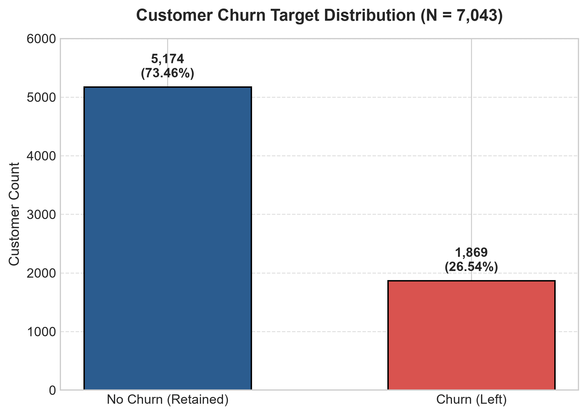

### 5.2 Tenure Distribution & Customer Attrition
Tenure displays a pronounced bimodal distribution among retained customers, who cluster heavily either in their initial months or at mature tenures (>60 months). In stark contrast, churners are overwhelmingly concentrated in early tenure (median churn tenure = 10 months vs. median retained tenure = 38 months).

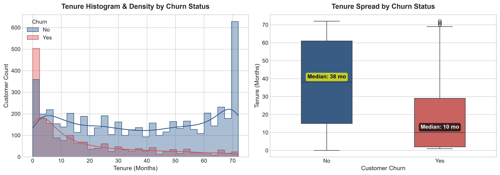

*Key Observation:* Customer vulnerability peaks in the first 12 months. Once a customer reaches 24 to 36 months of tenure, the probability of attrition drops dramatically.

### 5.3 Contract Architecture & Commitment
Contract structure exhibits the highest bivariate correlation with churn:
- **Month-to-month contracts:** 42.7% churn rate ($N = 3,875$).
- **One-year contracts:** 11.3% churn rate ($N = 1,473$).
- **Two-year contracts:** 2.8% churn rate ($N = 1,695$).

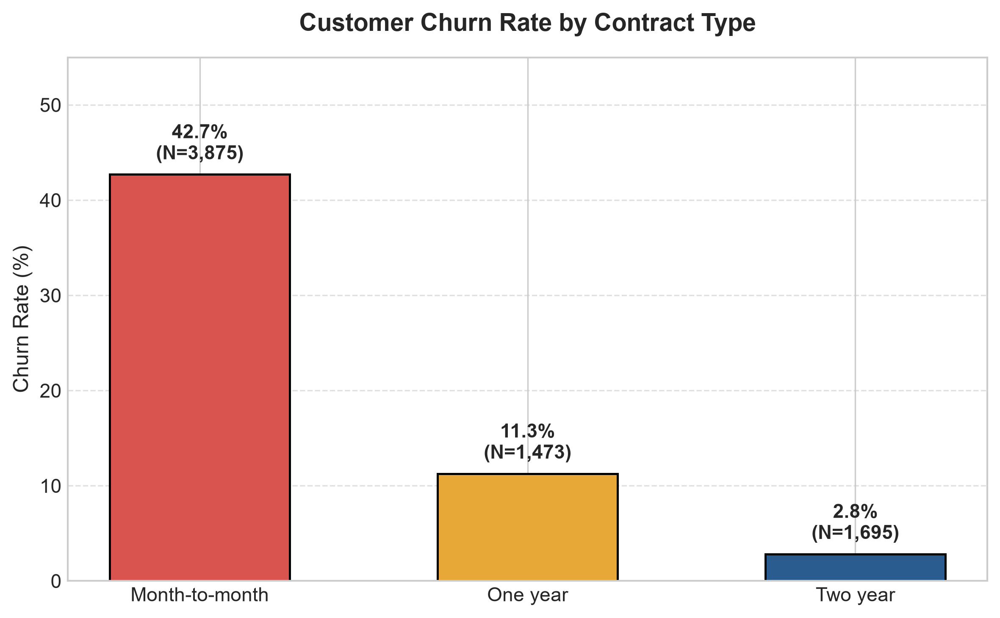

*Hypothesis:* Customers on month-to-month plans face zero contractual friction to switch to competing promotional offerings when dissatisfaction arises or price increases occur.

### 5.4 Internet Service & Value-Added Support Services
Customers subscribed to **Fiber optic** internet experience a **41.9% churn rate** ($N = 3,096$), compared to 18.9% for DSL ($N = 2,421$) and only 7.4% for accounts without internet service ($N = 1,526$).

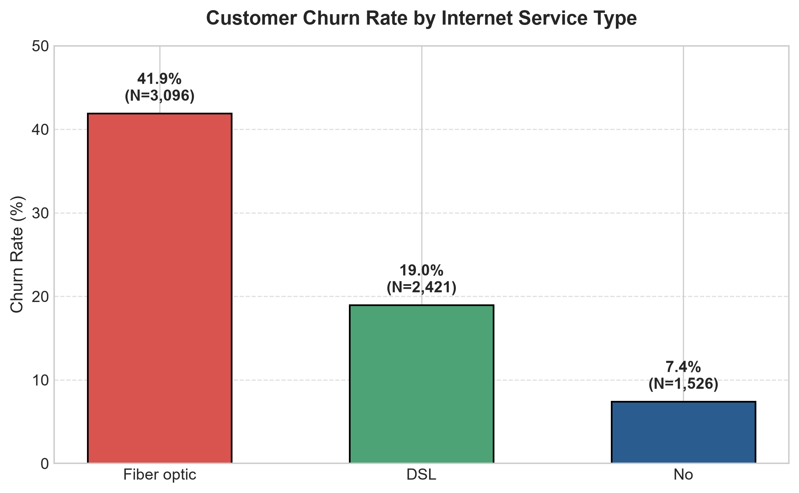

Further examination of service add-ons reveals that customers lacking `OnlineSecurity` or `TechSupport` churn at over 41%, whereas those with active `TechSupport` or `OnlineSecurity` churn at approximately 14% to 15%. Customers opting for `PaperlessBilling` experience a 33.6% churn rate compared to 16.3% for standard billing.

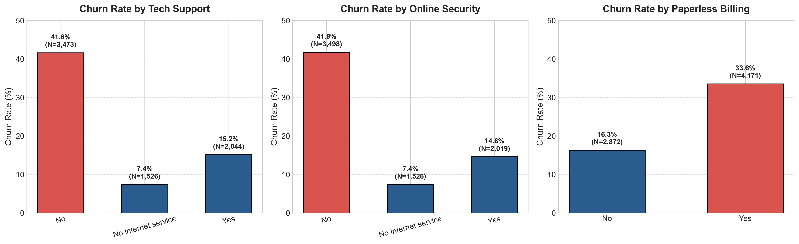

### 5.5 Payment Channels
Payment method analysis reveals that **Electronic check** users experience a **45.3% churn rate** ($N = 2,365$), whereas automated channels (`Bank transfer` and `Credit card`) exhibit churn rates between 15.2% and 16.7%.

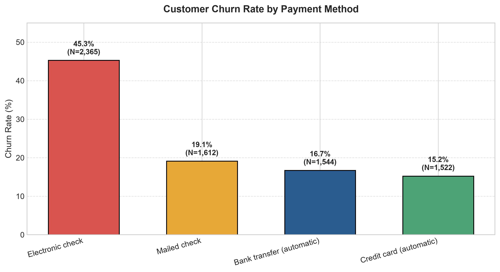

### 5.6 Billing & Correlation Analysis
- `MonthlyCharges` for churners show a higher median (\$79.65) compared to retained customers (\$64.43).
- `TotalCharges` exhibit strong collinearity with `tenure` ($r = 0.826$). Churners have a lower median total spend (\$703.55) than retained customers (\$1,683.60), directly driven by their truncated tenure.

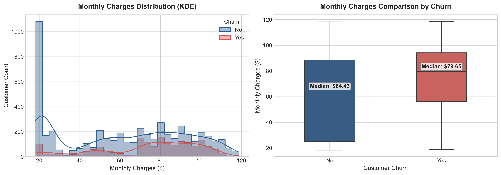
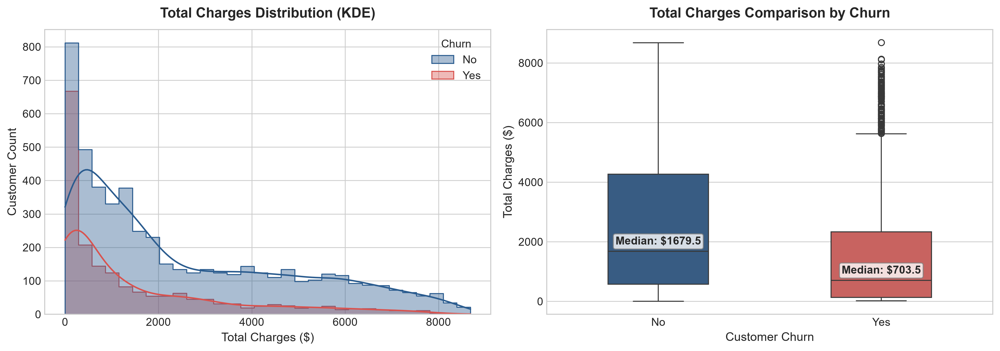
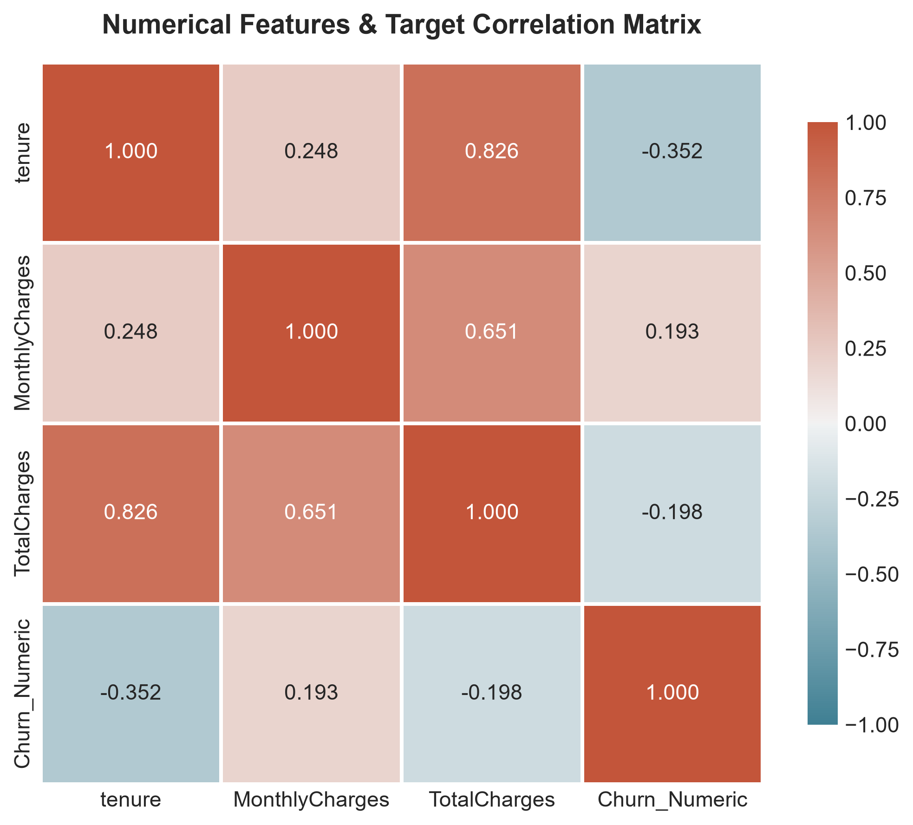

*Predictor Availability & Redundancy Discussion:*  
All candidate features—including contract, add-ons, monthly charges, and accumulated charges—are fully recorded in customer billing databases at monthly snapshot intervals. While `TotalCharges` is mathematically connected to `tenure` $\times$ `MonthlyCharges`, empirical modeling demonstrates that tree-based gradient boosting exploits subtle non-linear interactions between tenure, historical discounting, and rate adjustments captured by `TotalCharges`. It was therefore retained.

---

## 6. Preprocessing & Data-Splitting Strategy

### 6.1 Stratified Train/Test Split
To prevent data snooping and maintain identical class ratios across partitions, the cleaned dataset was split using `train_test_split` with `test_size=0.20`, `stratify=y`, and `random_state=42`:
- **Training Set:** 5,634 samples (4,139 No-Churn [73.46%], 1,495 Churn [26.54%])
- **Test Set:** 1,409 samples (1,035 No-Churn [73.46%], 374 Churn [26.54%])

The test set was set aside and remained completely untouched during feature engineering, model exploration, hyperparameter tuning, and threshold selection.

### 6.2 Leakage-Free Preprocessing Pipelines
All transformations were embedded inside an `sklearn.compose.ColumnTransformer`:
- **Numerical Pipeline (`tenure`, `MonthlyCharges`, `TotalCharges`):**
  1. `SimpleImputer(strategy='median')`: Ensures robust imputation on future inputs.
  2. `StandardScaler()`: Normalizes features to zero mean and unit variance for linear and scale-sensitive models.
- **Categorical Pipeline (16 categorical features):**
  1. `SimpleImputer(strategy='most_frequent')`: Fills potential missing categories.
  2. `OneHotEncoder(handle_unknown='ignore', sparse_output=False)`: Encodes discrete categories into binary indicator vectors while gracefully ignoring unseen levels encountered during future inference.

The preprocessor was fitted exclusively on training folds during cross-validation and once on the full training set prior to test evaluation.

---

## 7. Model Development & Baseline Comparison

### 7.1 Evaluated Classifiers
We benchmarked diverse classification algorithms representing varying complexity, inductive biases, and interpretability:
1. **Dummy Classifier (`strategy='most_frequent'`):** Trivial non-learning baseline predicting class `0`.
2. **Logistic Regression (Default & Balanced):** Parametric linear model optimizing log-loss.
3. **Decision Tree Classifier (Max Depth 5, Default & Balanced):** Interpretable non-linear tree partition.
4. **Random Forest Classifier (Default & Balanced):** Ensembling technique averaging decorrelated decision trees.
5. **Gradient Boosting Classifier:** Sequential boosting minimizing deviance residuals.
6. **HistGradientBoostingClassifier:** Binned boosting optimized for high throughput.

### 7.2 5-Fold Stratified Cross-Validation Results (Training Set)
All candidate models were evaluated on the 5,634 training records across 5 stratified folds.

| Classifier Variant | CV ROC-AUC | CV PR-AUC | CV F1-Score | CV Recall | CV Precision | CV Accuracy |
|---|:---:|:---:|:---:|:---:|:---:|:---:|
| **Dummy (Most Frequent)** | 0.5000 | 0.2654 | 0.0000 | 0.0000 | 0.0000 | 0.7346 |
| **Logistic Regression (Default)** | 0.8461 | 0.6615 | 0.5924 | 0.5438 | 0.6521 | 0.8042 |
| **Logistic Regression (Balanced)** | 0.8460 | 0.6601 | 0.6282 | **0.8013** | 0.5169 | 0.7410 |
| **Decision Tree (Max Depth 5)** | 0.8288 | 0.6139 | 0.5649 | 0.5130 | 0.6345 | 0.7932 |
| **Decision Tree (Balanced)** | 0.8275 | 0.6139 | 0.6152 | 0.7773 | 0.5097 | 0.7281 |
| **Random Forest (Default)** | 0.8180 | 0.6062 | 0.5403 | 0.4756 | 0.6271 | 0.7849 |
| **Random Forest (Balanced)** | 0.8216 | 0.6007 | 0.6025 | 0.6421 | 0.5676 | 0.7680 |
| **Gradient Boosting** | **0.8482** | **0.6676** | 0.5880 | 0.5291 | **0.6622** | **0.8060** |
| **HistGradientBoosting** | 0.8364 | 0.6471 | 0.5703 | 0.5124 | 0.6439 | 0.7971 |

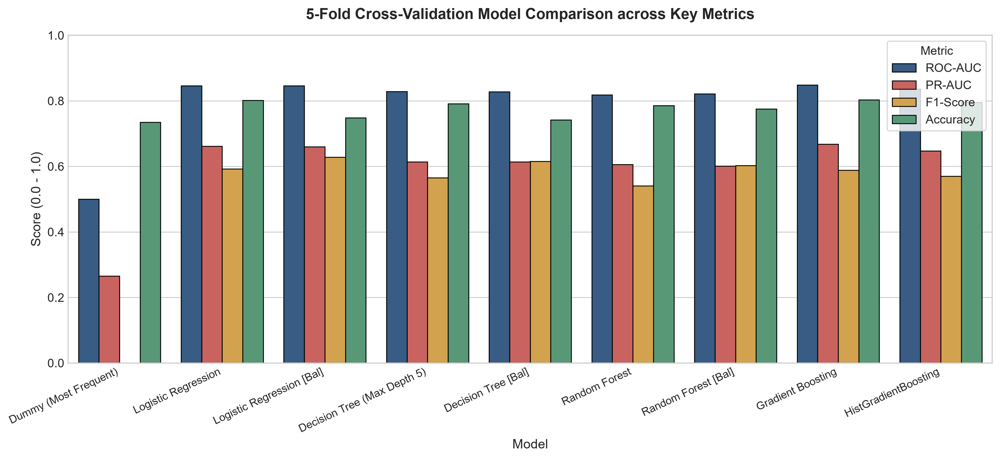

### 7.3 Overfitting Assessment
- **Random Forest (Default)** demonstrated substantial training memorization: Train ROC-AUC of 0.9998 versus Validation ROC-AUC of 0.8180 ($\Delta = 0.1818$), indicating overfitting.
- **Gradient Boosting** maintained tighter regularization: Train ROC-AUC of 0.8931 versus Validation ROC-AUC of 0.8482 ($\Delta = 0.0449$).
- **Logistic Regression** exhibited minimal variance: Train ROC-AUC of 0.8490 versus Validation ROC-AUC of 0.8461 ($\Delta = 0.0029$).

---

## 8. Hyperparameter Tuning Procedure

Hyperparameter optimization was executed using `GridSearchCV` with 5-fold Stratified K-Fold cross-validation on the training set. The optimization objective was explicitly set to **`average_precision` (PR-AUC)**. PR-AUC measures the area under the Precision-Recall curve across all potential decision cutoffs, which is critical for imbalanced target settings where true positive capture is paramount.

### Tuning Search Space & Best Configurations
1. **Gradient Boosting Classifier:**
   - Parameter grid: `n_estimators` $\in [100, 150, 200]$, `learning_rate` $\in [0.03, 0.05, 0.1]$, `max_depth` $\in [3, 4]$, `subsample` $\in [0.8, 1.0]$.
   - **Best Parameters:** `{'learning_rate': 0.03, 'max_depth': 3, 'n_estimators': 200, 'subsample': 0.8}`
   - **Best CV PR-AUC:** **0.6719** (an improvement over the default 0.6676).
2. **Random Forest Classifier:**
   - Parameter grid: `max_depth` $\in [8, 12, 16]$, `min_samples_split` $\in [5, 10]$, `n_estimators` $\in [100, 200]$, `class_weight` $\in [\text{None}, \text{'balanced'}]$.
   - **Best Parameters:** `{'class_weight': None, 'max_depth': 8, 'min_samples_split': 10, 'n_estimators': 200}`
   - **Best CV PR-AUC:** 0.6644.
3. **Logistic Regression:**
   - Parameter grid: $C \in [0.01, 0.05, 0.1, 0.5, 1.0, 5.0]$, `solver` $\in [\text{'lbfgs'}, \text{'liblinear'}]$.
   - **Best Parameters:** `{'C': 1.0, 'class_weight': None, 'solver': 'lbfgs'}`
   - **Best CV PR-AUC:** 0.6615.

The tuned **Gradient Boosting Classifier** achieved the highest cross-validation PR-AUC (0.6719) and was selected as the final production model.

---

## 9. Final Test-Set Evaluation & Threshold Selection

The final tuned Gradient Boosting pipeline was refitted once on the entire training set ($N = 5,634$) and evaluated on the held-out test partition ($N = 1,409$).

### 9.1 Overall Discrimination & Calibration Metrics
- **Test ROC-AUC:** **0.8463** (demonstrating strong rank-ordering separation).
- **Test PR-AUC (Average Precision):** **0.6608** (over 2.49$\times$ the 26.54% empirical baseline).
- **Brier Score:** **0.1351** (reflecting well-calibrated probabilistic estimates; lower is superior, with 0.0 being perfect).

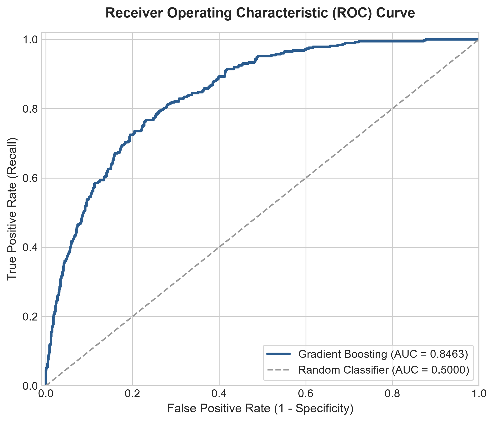
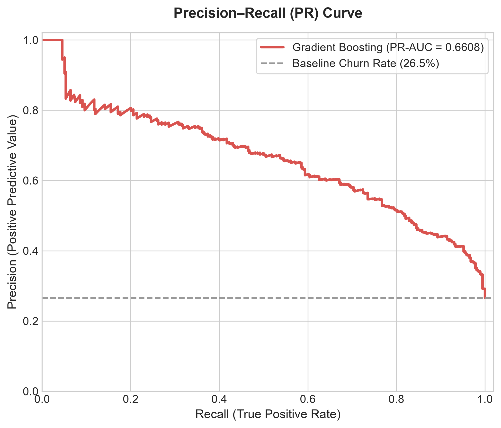
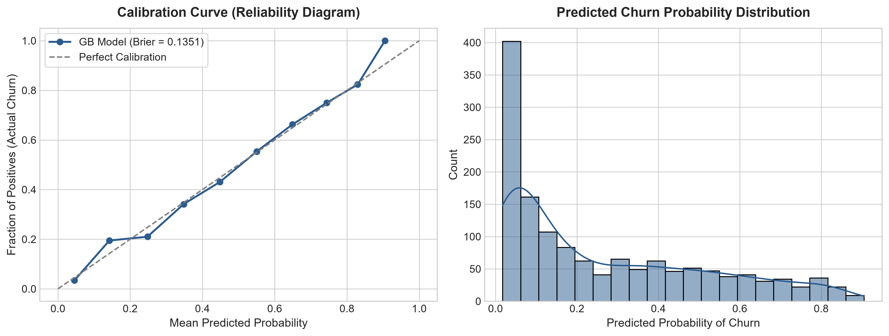

### 9.2 Decision Threshold Optimization & Operational Trade-offs

In real-world customer retention, the default threshold of $0.50$ is rarely optimal because the business costs of errors are asymmetric:
- **Cost of False Negative (FN):** A high-value customer churns uncontacted, losing recurring revenue.
- **Cost of False Positive (FP):** An incentive or retention outreach is offered to a customer who would have stayed anyway.

#### Methodological Integrity in Threshold Selection
To prevent optimistic bias, **the operating threshold was selected strictly using Out-Of-Fold (OOF) cross-validation predictions on the training set**. Sweeping probability thresholds from 0.10 to 0.90 identified **$t^* = 0.32$** as the threshold that maximizes the OOF F1-score (0.6436).

This pre-selected threshold of 0.32 was then applied directly to the test set:

| Evaluation Metric | Default Threshold (0.50) | Tuned Threshold (0.32) | Operational Impact of Shift |
|---|:---:|:---:|---|
| **Accuracy** | 80.48% | 77.08% | Slight decrease (-3.40%) |
| **Precision (Positive Predictive Value)**| 67.13% | 55.11% | Decreases (-12.02%); 55% of flagged accounts churn |
| **Recall (Sensitivity / Churn Capture)** | **51.87%** | **73.53%** | **Massive increase (+21.66%); captures 3 out of 4 churners** |
| **F1-Score** | 0.5852 | **0.6300** | **Net balance improvement (+0.0448)** |
| **Specificity (True Negative Rate)** | 90.82% | 78.36% | Fewer non-churners left uncontacted |
| **True Positives (TP)** | 194 | **275** | **+81 additional churners identified and saved** |
| **False Negatives (FN - Missed Churners)**| 180 | **99** | **Missed churners cut nearly in half (-81)** |
| **False Positives (FP - Outreach Wasted)**| 95 | 224 | +129 non-churners contacted |
| **True Negatives (TN)** | 940 | 811 | -129 |
| **Total Customers Contacted** | 289 (20.5% of base) | 499 (35.4% of base) | Retention campaign volume scaled to capacity |

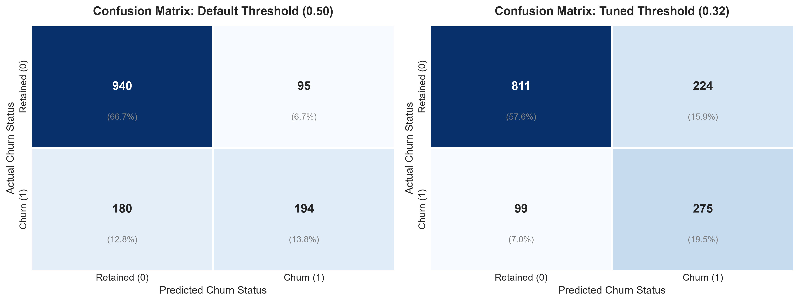

#### Retention Team Capacity Analysis
- If retention capacity is strictly limited (e.g., dedicated telephone concierge agents who can only contact 15–20% of the customer base), operating at threshold $0.50$ provides high precision (67.13%), ensuring minimal wasted agent effort.
- If proactive retention utilizes automated, low-cost digital touchpoints (e.g., targeted email discounts, in-app service upgrade offers, free speed boost for one month), the **0.32 threshold is vastly superior**, ensuring that 73.53% of at-risk revenue is addressed.

---

## 10. Model Interpretation & Predictive Drivers

To provide interpretable insights without data distortion, **Permutation Feature Importance** was computed on the test set across 10 random permutations, measuring the mean decrease in PR-AUC.

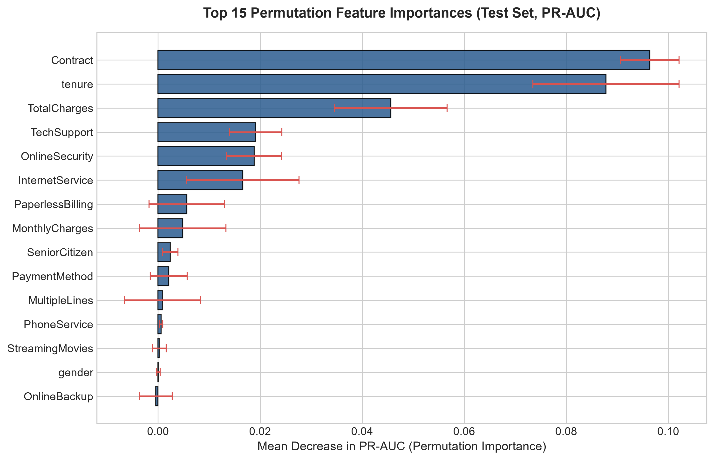

### 10.1 Top Predictive Drivers

| Feature Name | Mean Importance ($\Delta$ PR-AUC) | Std Importance | Directional Association & Observed Pattern |
|---|:---:|:---:|---|
| **`Contract`** | **0.0964** | 0.0057 | **Strongest predictor.** Month-to-month contracts strongly associate with churn; 1- and 2-year contracts correlate with high retention. |
| **`tenure`** | **0.0878** | 0.0143 | **Strong negative association.** Early-stage customers (<12 months) display the highest attrition risk. |
| **`TotalCharges`** | **0.0456** | 0.0110 | Reflects cumulative customer value and longevity; interaction with tenure signals billing stability. |
| **`TechSupport`** | **0.0191** | 0.0051 | Customers without technical support show elevated churn (~41.6% vs ~15.2%). |
| **`OnlineSecurity`** | **0.0188** | 0.0054 | Active security bundles strongly associate with retention. |
| **`InternetService`** | **0.0166** | 0.0110 | Fiber optic subscribers churn at 41.9%, versus 18.9% for DSL. |
| **`PaperlessBilling`** | **0.0056** | 0.0074 | Paperless subscribers show higher churn rates (33.6% vs 16.3%). |
| **`MonthlyCharges`** | **0.0048** | 0.0085 | Higher ongoing monthly charges correlate with greater sensitivity to competitive pricing. |
| **`PaymentMethod`** | **0.0021** | 0.0036 | Electronic check payments associate with elevated churn compared to automated direct debits. |

### 10.2 Critical Governance Note on Association vs. Causality
> [!IMPORTANT]
> **Statistical Association Does Not Establish Causation.**  
> While the model identifies that `Fiber optic` users churn at a 41.9% rate, this does **not** prove that fiber technology causes customers to cancel. Possible confounding variables not captured in this cross-sectional snapshot include:
> 1. Fiber optic plans may carry higher initial promotional rates that expire after 12 months, triggering price shock.
> 2. Specific geographic regions with fiber optic coverage may experience aggressive competitor fiber rollouts or pricing wars.
> 3. Fiber subscribers may be high-bandwidth power users with stricter quality-of-service and latency expectations.

---

## 11. Interactive Decision-Support Tool (Streamlit Application)

To bridge machine learning artifacts and daily retention operations, a production-grade Streamlit application was developed (`app.py`).

### 11.1 Functional Capabilities
- **Direct Pipeline Loading:** Loads the identical trained scikit-learn pipeline (`outputs/models/best_model_pipeline.joblib`), ensuring 100% inference parity without duplicate preprocessing code.
- **Dynamic Threshold Configuration:** Allows operators to toggle between the **Optimized F1 Threshold (0.32)**, the **Standard Threshold (0.50)**, or custom values based on weekly team outreach quotas.
- **Profile Presets:** One-click presets ("High Risk Profile" and "Low Risk Profile") allow rapid scenario stress-testing.
- **Risk Stratification:** Classifies prospects into three clear operational tiers:
  - **Critical Risk ($\ge 60\%$):** Immediate priority human concierge intervention.
  - **Elevated Risk ($32\% - 60\%$):** Automated targeted digital incentives (contract discounts, free security add-ons).
  - **Low Risk ($< 32\%$):** Standard account maintenance.
- **Transparent Risk Indicators:** Deconstructs specific customer risk attributes and protective factors to guide representative dialogue.

### 11.2 Verified Application Screenshot (Dark Mode Edition)
The Streamlit application was deployed locally in a cohesive Dark Mode design and verified via automated headless Edge DevTools capture:


*Figure 16 Inspection:* The screenshot confirms complete component rendering under a unified dark slate palette (`#0e1117`), high-contrast typography, interactive input tabs, probability gauge display (53.8% risk score), risk tier badge (`ELEVATED RISK`), prescriptive retention playbook callout, and governance disclaimer.

---

## 12. Business Recommendations for Customer Retention

Based on model interpretations and empirical validation, the business should implement a four-pillar retention framework:

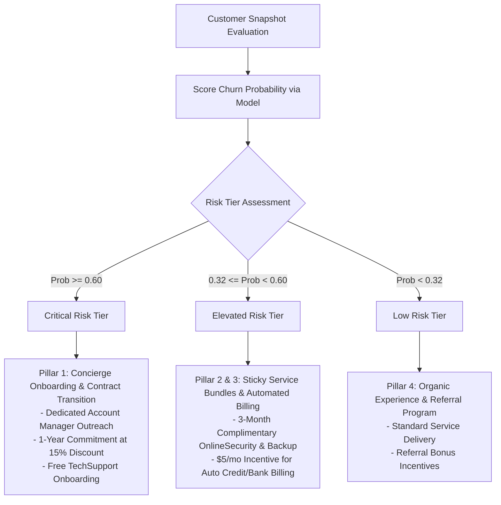

### Pillar 1: First-Year Onboarding & Contract Transition
- **Insight:** Over 55% of all churn occurs within the first 12 months, predominantly on month-to-month contracts.
- **Action:** Introduce an "Early Tenure Loyalty Program" between months 3 and 9. Offer customers on month-to-month plans an annualized rate guarantee or a 10–15% bill credit in exchange for converting to a 12-month agreement.

### Pillar 2: "Sticky" Service Add-on Bundling
- **Insight:** Customers subscribing to `OnlineSecurity` or `TechSupport` have churn rates roughly one-third of customers without these services (15% vs. 41%).
- **Action:** Package digital security and 24/7 technical assistance into standard fiber optic and broadband tiers at zero or nominal cost rather than selling them as separate add-ons. Increasing service interdependency raises natural customer switching barriers.

### Pillar 3: Automated Payment Conversion
- **Insight:** Electronic check users churn at 45.3%, compared to 15.2% for automated bank transfers. Electronic checks introduce monthly manual friction and bill awareness.
- **Action:** Offer a recurring $3–$5 monthly bill credit for switching from electronic or mailed checks to automated credit card or ACH direct debit billing.

### Pillar 4: Fiber Optic Quality & Pricing Audit
- **Insight:** Fiber optic churn is disproportionately high (41.9%) despite representing the company's flagship high-speed offering.
- **Action:** Conduct an engineering and customer-care audit of fiber optic nodes to investigate potential unaddressed network instability, customer support escalations, or pricing jumps following introductory teaser periods.

---

## 13. Limitations, Risks & Future Improvements

### 13.1 Data & Methodological Limitations
1. **Cross-Sectional Snapshot Nature:** The dataset contains a single static cross-sectional snapshot without timestamped event histories, network usage telemetry (e.g., bandwidth consumed, dropped calls), or customer service ticket counts.
2. **Absence of Competitive Context:** Local competitive intensity (e.g., promotional aggressive fiber rollouts by competitors in specific zip codes) is unrecorded.
3. **Survivor Bias in Tenure:** Customers with 60+ months of tenure inherently represent resilient cohorts. Direct comparisons between young and mature accounts must account for this survival dynamic.

### 13.2 Operational Risks & Monitoring
1. **Incentive Cannibalization:** Offering retention discounts to customers who were not genuinely planning to leave (False Positives) erodes revenue margins. Threshold tuning must be reviewed against actual intervention marginal costs.
2. **Model Concept Drift:** Customer preferences, inflationary pressures, and competitor pricing evolve. The model must not remain static.

### 13.3 Recommended Technical Improvements
1. **Longitudinal Event Modeling:** Integrate dynamic time-series features (e.g., month-over-month usage drop, payment delay changes, inbound complaints).
2. **Uplift Modeling:** Shift from predicting churn probability $P(\text{Churn})$ to predicting treatment effect $\tau = P(\text{Churn} \mid \text{Outreach}) - P(\text{Churn} \mid \text{No Outreach})$ to identify truly persuadable customers rather than doomed accounts.
3. **Automated MLOps Pipeline:** Establish scheduled retraining, data drift monitoring via Population Stability Index (PSI), and A/B testing of model-driven retention campaigns.

---

## 14. Reproducibility Instructions & Software Specifications

### 14.1 Software Environment
The project was executed in a clean Python 3.15.1 environment on Windows. Key dependencies specified in `requirements.txt`:

```text
numpy>=2.0.0
pandas>=2.0.0
scikit-learn>=1.4.0
matplotlib>=3.8.0
seaborn>=0.13.0
joblib>=1.3.0
scipy>=1.12.0
streamlit>=1.30.0
```

### 14.2 Step-by-Step Reproduction Guide

To reproduce all artifacts, figures, models, and evaluation outputs from scratch, execute the following commands from the repository root:

```bash
# 1. Install required packages
pip install -r requirements.txt

# 2. Run Exploratory Data Analysis (generates figures 01 to 09)
python src/eda.py

# 3. Run Training, Sensitivity Analysis & Tuning (generates cross-validation metrics)
python src/train.py

# 4. Run Final Evaluation & Interpretation (generates figures 10 to 15 and saved pipeline)
python src/evaluate.py

# 5. Launch the Streamlit Interactive Decision-Support App
python -m streamlit run app.py
```

### 14.3 Deliverable Directory Index
```text
Customer Churn Prediction with Supervised Classifiers/
├── dataset/
│   └── Telco-Customer-Churn.csv             # Source dataset
├── src/
│   ├── __init__.py                          # Package identifier
│   ├── data_preprocessing.py                # Cleaning, splits & ColumnTransformer pipeline
│   ├── eda.py                               # Comprehensive EDA visual generator
│   ├── train.py                             # Baseline comparison, sensitivity & GridSearchCV
│   └── evaluate.py                          # Test evaluation, threshold tuning & interpretation
├── outputs/
│   ├── figures/                             # 16 High-resolution figures (01 to 15 + Streamlit app)
│   ├── models/
│   │   └── best_model_pipeline.joblib       # Production fitted pipeline (Preprocessor + Model)
│   └── metrics/                             # Machine-readable JSON metrics & sensitivity records
├── notebooks/
│   └── churn_project.ipynb                  # Documented interactive notebook walkthrough
├── scripts/
│   ├── capture_screenshot.py                # Automated headless Edge CDP capture script
│   └── create_notebook.py                   # Notebook generator
├── app.py                                   # Streamlit decision-support web application
├── requirements.txt                         # Package specifications
├── TASK.md                                  # Original project specification
└── final_report.md                          # Mandatory comprehensive project report
```
